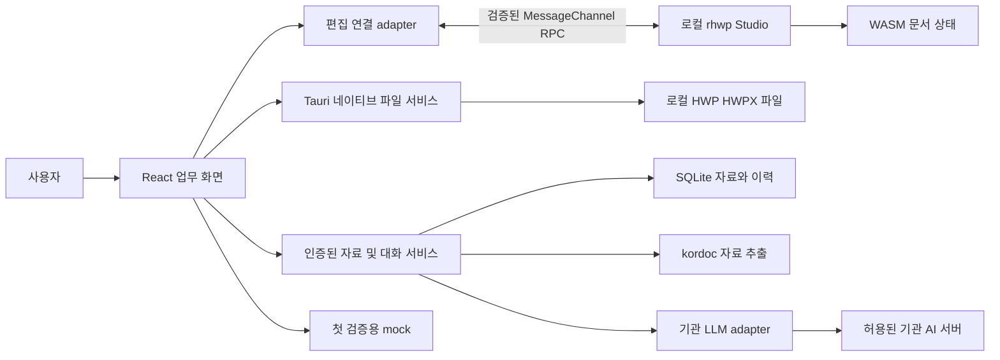
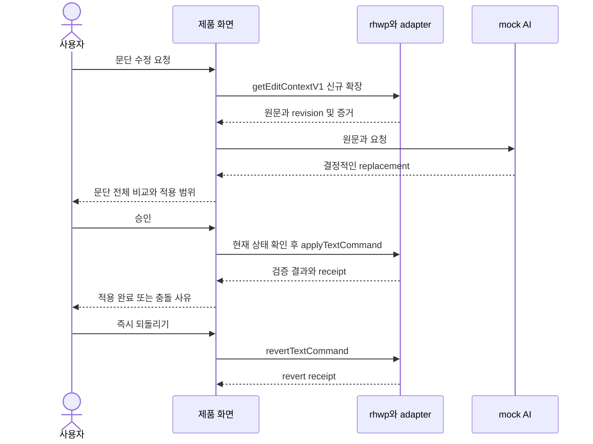

# 편집 엔진 연결 설계

열린 문서의 유일한 내용 기준은 rhwp Studio가 소유한 WASM 문서다. 호스트 앱은 파일 경로·업무·대화·수정안·저장 결과를 관리한다. Python은 참고 자료의 추출·검색과 새 문서 생성에 사용한다. Python이 열린 원본을 직접 patch하거나 별도의 rhwp 인스턴스로 같은 문서를 수정하는 경로는 만들지 않는다.

## 구성과 책임



첫 검증에서는 자료·대화 서비스, kordoc, 기관 LLM을 연결하지 않아도 된다. Tauri의 파일 처리, 로컬 Studio, 문맥 adapter, mock, 비교·승인 흐름만으로 편집 가능성과 저장 품질을 검증한다. Python sidecar와 Node 파서 런타임은 자료 기능을 추가할 때 포함한다.

| 상태 | 소유자 | 다른 계층의 접근 |
| --- | --- | --- |
| 문서 내용·선택·서식·undo·dirty·revision | rhwp Studio | 읽기 snapshot 또는 검증된 명령 |
| 경로·디스크 해시·저장 권한·저장 작업 | 네이티브 파일 서비스 | 허용된 document handle로만 접근 |
| 제안·diff·승인·receipt | 제품의 proposal 서비스 | 원문 snapshot과 문서 revision에 결합 |
| 자료 추출·색인·출처 | Python 자료 서비스 | scope를 확인한 검색 요청 |
| 기관 자격증명·전송 정책 | 신뢰된 네이티브 또는 sidecar 경계 | iframe·브라우저 저장소에 키 전달 금지 |

## 로컬 Studio 연결

현재 wrapper의 기본 URL은 외부 GitHub Pages이며 Studio URL과 부모 origin 모두 HTTP(S)가 필요하다. 첫 검증의 우선안은 앱에 포함된 정적 Studio·WASM·허용 글꼴을 **loopback 정적 자산 서버**로 제공하고, `studioUrl`을 명시하는 방식이다. 서버는 `127.0.0.1`에 바인딩하고 OS가 할당한 포트를 사용한다. 임의 파일 읽기 API는 제공하지 않는다.

Tauri의 Windows 패키지에서 실제 부모 `location.origin`을 측정한다. HTTP(S)로 표현되지 않는 경우 현재 transport를 통과한다고 가정하지 않는다. 대안은 Windows에서 HTTP(S) origin으로 제공되는 로컬 자산 프로토콜의 사용 가능성을 확인하는 것이다. 다른 origin을 허용하려면 양쪽 프로토콜 검증을 명시적으로 수정해야 하며 `*` origin 허용으로 해결하지 않는다.

첫 연결 검증에서는 다음을 확인한다.

1. 부모 origin·iframe origin·WASM URL·폰트 URL·실제 로드 파일 해시를 기록한다.
2. `document-state-v1`, `selection-context-v1`, `document-agent-command-v1`, `target-navigation-v1`, `notify-saved-v1` capability를 협상한다. mutation은 legacy fallback으로 실행하지 않는다.
3. Tauri CSP의 `frame-src`에 실제 로컬 Studio 경로의 origin을 허용한다. 기존 `connect-src`가 loopback을 허용해도 iframe 허용을 대신하지 않는다. iframe의 자체 CSP에도 외부 연결을 허용하지 않는다.
4. iframe에 네이티브 임의 파일 접근·키 접근·shell 실행 권한을 주지 않는다. 상위 프레임만 파일 서비스를 호출하며 message source·origin·session을 검증한다.
5. `RHWP_DISABLE_EXTERNAL_WEBFONTS=1`로 빌드하고, remote document URL·외부 이미지·도움말·업데이트 등 런타임 요청을 감사한다. 외부 폰트 옵션 하나만으로 전체 네트워크 차단이 완료되었다고 보지 않는다.
6. 기존 browser cache·service worker가 없는 프로필에서 인터넷을 끊고 재실행한다. 서비스워커는 첫 검증에서 사용하지 않는 구성을 우선하며, 사용하면 번들 버전과 캐시 무효화도 시험한다.

loopback 정적 서버와 이후 데이터 API는 별도 표면이다. 데이터 API에는 프로세스 수명에 묶인 난수 인증 토큰과 요청 origin·Host 검사를 추가한다. 토큰을 URL·로그에 남기지 않는다. CORS는 인증 대체 수단이 아니다. endpoint 변경, redirect, 인증서 신뢰를 포함한 전송 정책은 기관 설정으로 제한한다.

## 문맥 adapter

공개 `getSelectionContext()`에는 원문과 적용에 필요한 모든 해시가 없다. 새 `getEditContextV1`은 **제품에서 추가할 제안 API 이름**이며 기존 rhwp API로 사용하면 안 된다.

가장 작은 구현 후보는 Studio 내부 `collectTargetEvidence`를 재사용하는 읽기 전용 확장이다. 기존 plugin의 `read`·DocumentLease와 `plugins.invoke` 표면을 먼저 검토하되, 현재 PluginHost에는 controller의 changeSeq와 전체 문맥 수집 API가 없으므로 이것만으로 구현이 끝난다고 가정하지 않는다. 필요한 경우 Studio 조립점에 versioned RPC를 하나 추가하여 같은 controller에서 상태·선택·증거를 수집한다. SHA 계산을 Python이나 부모 화면에 별도로 복제하지 않는다.

아래는 제품 내부의 논리 계약이다. 그대로 upstream v1 명령에 추가 필드를 붙이지 않는다. 기존 명령 validator는 extra key를 거부한다.

```text
EditContextV1
  contextId, documentId
  documentEpoch, changeSeq, documentSha256
  target { kind, section, paragraph, charOffset: 0, length }
  beforeText
  beforeSha256, formatSha256, adjacentContextSha256
  beforeNeighborText?, afterNeighborText?  // 표시·프롬프트용 제한된 발췌
  selectionKind, editable, blockedReason?, page

EditProposal
  proposalId, contextId, requestId
  replacement, explanation, citationIds[], provider: mock | institution
  state: proposed | rejected | stale | applying | applied | reverting | reverted | failed | unknown
  commandId?, applyReceipt?, revertReceipt?
```

context 수집은 같은 문서 세대·seq에서 원자적으로 수행한다. 여러 비동기 읽기로 나눠야 하면 전후 revision을 확인하고 바뀌면 폐기한다. 편집 대상은 화면 좌표나 텍스트 유사도로 다시 찾지 않는다. 원문은 LF·공백·유니코드 정규화 없이 engine이 반환한 문자열을 기준으로 해시를 계산한다. 화면 표시용 가공과 명령용 원문을 분리한다.

커서만 있으면 해당 본문 문단 전체를 대상으로 표시한다. 여러 문단·표·글상자·머리말에 걸친 선택은 거부한다. 문단 일부 선택에 전체 교체를 적용할 때는 승인 화면에 전체 문단을 반드시 보여준다. IME 조합 완료 후 snapshot을 받으며, 화면 diff는 grapheme 단위로 읽기 쉽게 표시하더라도 명령의 길이·offset은 engine 계약을 따른다.

## 제안과 적용



모델은 replacement와 설명만 만든다. 경로·target·해시·승인 상태를 모델이 결정하지 않는다. 자료 속 지시문은 참고 데이터이며 실행 명령이 아니다. 모델 출력에는 길이·제어문자·스키마 검사를 적용하고, 조건에 맞지 않으면 제안 단계에서 실패시킨다.

적용 시 기존 명령에 `expectedDocumentEpoch`, `expectedChangeSeq`, `expectedDocumentSha256`, `expectedBeforeSha256`, `expectedFormatSha256`, `expectedAdjacentContextSha256`를 전달한다. 모든 문서 mutation과 저장은 document별 큐로 직렬화한다. wrapper의 10초/60초 전송 timeout과 controller의 3초 편집 예산은 별도다.

| 상황 | 제품 처리 |
| --- | --- |
| 제안 이후 직접 편집·문서 교체·인접 서식 변경 | 기존 제안을 stale로 표시하고 새 문맥에서 재제안 |
| 페이지 수 변경·서식 변화·비대상 변화 | 실패 사유를 보여주고 복구 성공 여부를 확인 |
| `recovered: false` 또는 상태를 확인할 수 없음 | 적용·저장을 잠그고 복구 안내; 원본을 덮어쓰지 않음 |
| 동일 명령의 중복 클릭 | 같은 commandId·내용으로 한 건만 처리; 중복 요청 검증 |
| timeout이나 연결 단절 | 성공 여부 unknown. 새 commandId로 무작정 재전송하지 않음. 같은 세션의 검증 가능한 재조회·동일 명령 receipt 재응답 경로 사용 |
| 후속 수동 편집 뒤 AI 되돌리기 | 현재 API의 recent-command 조건에 따라 거부; 과거 원문을 강제로 덮어쓰지 않음 |

engine journal은 문서 재로드 시 사라진다. 제품에 receipt를 저장해도 재실행 후 `revertTextCommand`가 자동 복구되는 것은 아니다. 첫 검증의 되돌리기는 같은 열린 문서 세션의 즉시 취소다. 장기 변경 이력 복원은 이후 별도 기능으로 설계한다.

## 안전한 파일 저장

디스크 파일 해시와 `documentSha256`를 같은 값으로 취급하지 않는다. 전자는 실제 파일 bytes이며 후자는 engine의 현재 형식 직렬화 bytes에서 계산된다. 각자 외부 파일 변경 검사와 편집 상태 검사에 사용한다.

첫 검증은 **같은 형식으로 다른 이름 저장**을 기본으로 한다. 원본 덮어쓰기·HWP↔HWPX 변환은 별도 시험이다. 출력 이름에 적용본·되돌림본을 구분하여 두 동작을 각각 검사한다.

1. 네이티브가 사용자가 선택한 저장 대상과 document handle을 연결한다. renderer가 임의 경로 문자열로 모든 파일을 쓸 수 없게 한다.
2. Studio 수준의 저장 gate를 획득한다. 키보드·붙여넣기·IME·automation·AI apply·문서 교체 등 모든 mutation 진입점을 포함한다. 화면 위에 overlay만 올리는 것은 충분하지 않다.
3. `epoch`, `changeSeq`, 문서 해시를 저장 ticket에 고정하고 해당 형식으로 export한다. export는 디스크 저장 성공을 의미하지 않는다.
4. 대상과 같은 디렉터리에 임시 파일을 쓰고 flush·닫기·bytes 검증 후 교체한다. 원본 덮어쓰기에서는 대상 identity·mtime·크기·내용 해시와 가능한 OS 잠금으로 검사-교체 사이의 외부 변경도 방어한다. 다른 이름 저장도 기존 파일을 묵시적으로 덮어쓰지 않는다.
5. 쓰기 실패·권한 거부·파일 잠김·용량 부족에서는 원본과 복구본을 보존한다. Windows·NTFS에서 교체·프로세스 중단 동작을 실제 시험한다.
6. 성공한 bytes가 ticket의 문서 세대·revision과 일치하는 동안에만 `notifySaved`를 호출하고 완료를 기다린다. 잠금을 해제한 뒤 상태를 표시한다.

현재 `notifySaved(fileName?)` 자체에는 revision 검사가 없고 clean 처리 뒤 draft 삭제를 기다린다. 그래서 제품 adapter에 ticket을 검증하는 완료 동작을 추가하거나, export 시작부터 notify 완료까지 mutation을 실제로 막아야 한다. 파일은 저장됐지만 통지 또는 draft 정리가 실패하면 두 결과를 구분해 표시하고 성공한 저장을 반복 적용하지 않는다.

향후 편집을 잠그지 않는 비동기 저장을 지원하려면 `completeSave(ticket)`가 최신 revision과 같은 경우만 clean으로 전환해야 한다. 저장 중 새 편집이 발생하면 파일 저장 성공과 현재 문서 dirty를 동시에 유지한다. 이 역시 새 계약이며 기존 API가 제공하는 기능으로 문서화하지 않는다.

## 업무 자료와 검색의 후속 설계

| 개념 | 주요 필드 | 불변 조건 |
| --- | --- | --- |
| Workspace | id, name, policyId | 세션과 작업 문서는 반드시 하나의 업무에 속함 |
| Resource | id, scope, workspaceId?, requestId?, sourceKind, originPath, managedPath | scope에 맞는 소유 필드를 검사 |
| ResourceRevision | id, resourceId, sourceSha256, parserVersion, indexedAt, status | 색인과 출처는 같은 revision을 참조 |
| EvidenceChunk | revisionId, logicalLocator, text, pageHint?, extractor | 파서가 보장하지 않는 쪽수·셀 번호 생성 금지 |
| Conversation과 Request | workspaceId, requestId, selectedResourceIds | 검색·전송 범위를 요청마다 고정 |
| DocumentSession | documentId, workspaceId, fileIdentity, diskSha256 | 미저장 본문은 engine에서만 읽음 |

검색 허용 집합은 명시적으로 선택된 공통 자료 + 현재 업무 자료 + 현재 요청의 임시 자료다. 범위 조건을 SQL·FTS 후보 수집 단계에서 적용하고 반환 직전 다시 확인한다. UI 필터만으로 격리를 구현하지 않는다. 전역 cache를 쓰더라도 접근 권한과 검색 scope는 별도로 검증한다.

임시 첨부는 수신 → 관리 공간 복사 → 파일 검증 → 파싱 → chunk/임시 색인 → 질문 관련 검색 → 근거 선택 순으로 처리한다. 분석 중·오류·암호 문서·크기 제한·취소를 상태로 표시한다. HWP 파서가 추출한 논리 위치와 편집기의 문단 target은 자동으로 같은 주소라고 간주하지 않는다.

초기 검색은 기존 FTS5를 활용하고, 필요성 측정 없이 벡터 DB나 GraphRAG를 선행 도입하지 않는다. 원문이 바뀌면 출처 revision을 고정해 재현하거나 오래된 근거로 표시한다. 허용된 서버에는 선택한 문단과 관련 발췌만 보내며 원본 파일 전체 전송은 별도 정책과 UI에 따른다.

## 기관 API adapter

mock과 기관 adapter는 같은 제안 결과 스키마를 반환한다. OpenAI 호환 기관 gateway면 기존 `llm.py`를 제한된 provider로 감싸고, 고유 규격이면 별도 변환기를 만든다. 현재 `custom_openai` 비스트리밍은 `/responses`를 먼저 호출하므로, CLOVA 연결에서는 확인된 `/chat/completions`를 직접 선택하는 옵션이나 전용 adapter를 둔다. 모델·지원 필드·스트리밍 종료·오류·timeout·취소·재시도·기관 CA 인증서를 계약 시험한다.

재시도는 생성 요청에만 적용하며 문서 mutation을 자동 재시도하는 근거가 되지 않는다. API 키는 OS 비밀 저장소에 보관하고 실패 시 평문으로 내리지 않는다. TLS 검증을 끄는 우회는 설계에 포함하지 않는다. 요청 본문·파일 경로·키가 일반 진단 로그에 남지 않도록 로그 정책을 분리한다.

현재 API와 제약의 출처는 [소스 재검증](02-source-audit.md)의 R1~R9, G1~G8이며, 이 문서의 신규 API·데이터 모델·저장 gate는 구현 전 설계안이다.
