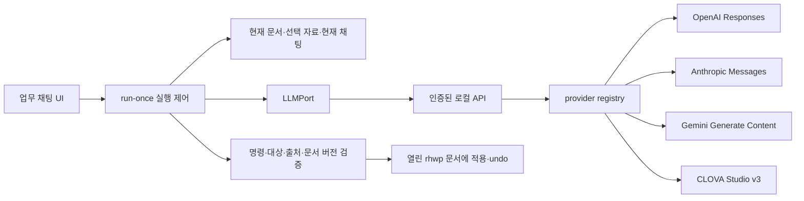

# LLM 제공자 4종 adapter 구현 명세

기준: 2026-10-11 / Jueony 현재 소스와 공식 API 문서 재확인.
사용자 선택: 일반 NAVER Cloud 개발 계정부터 연결한다. “germi”는 Google Gemini로 해석한다.
이 문서는 구현된 기능과 다음 구현 작업을 구분한다. 계정별 모델 사용 가능 여부를 대신 보증하지 않는다.

2026-10-11 후속 구현: 공통 편집 명령이 본문 4종에서 10종으로 확장됐다. HCX-005 함수 인수는 `message`, `sourceIds`, `operationsJson`이며 adapter가 문자열을 JSON 명령 배열로 파싱한 뒤 본문 원문을 대조한다. 앱에서 모든 명령의 대상·인자·revision을 다시 검증한다. 함수 인수의 복잡한 중첩 schema로 발생한 실제 40009를 해결한 고정 계약이며 자동 폴백이 아니다. [표·서식·쪽 설정 실호출 결과](17-editor-control-implementation.md)를 참고한다.

## 1. 현재 상태와 목표

| 제공자 / adapter ID | 연결 규격 | 이번 작업의 상태 |
| --- | --- | --- |
| GPT / `openai-responses` | OpenAI Responses | 전용 adapter 구현 명세 완료, 코드 미구현 |
| Claude / `anthropic` | Anthropic Messages | 구현 명세 완료, 코드 미구현 |
| Gemini / `gemini` | Gemini Generate Content | 구현 명세 완료, 코드 미구현 |
| HyperCLOVA X / `hyperclova` | CLOVA Studio v3: HCX-005 함수 호출 / HCX-007 Structured Outputs | 서비스 HCX-005 실호출 문서 흐름 통과. 초안 품질·기관망 검증은 별도 |
| 기존 `openai-compatible` | Chat Completions 호환 | 유지. GPT 등의 호환 endpoint를 입력할 수 있으나 제공자별 실호출은 별도 검증 필요 |

MVP는 모델을 한 번 호출하고 완성된 응답을 검증한 뒤 편집한다. 스트리밍 편집, 자동 재시도, 제공자 자동 전환, RAG, 자율 실행 loop는 추가하지 않는다. 네 제공자를 전부 구현한 상태처럼 UI에 표시하지 않는다.

## 2. 의존성 및 파일 경계



| 책임 | 현재 파일 / 추가할 파일 |
| --- | --- |
| 공통 입력과 LLM Port | `apps/editor/src/mvp/llm.ts` |
| 설정·출력·편집 명령 타입 | `apps/editor/src/mvp/model.ts` |
| 자료/대화 범위와 예산 | `apps/editor/src/mvp/context.ts` |
| 호출 횟수·취소·문서 충돌·실행 상태 | `apps/editor/src/mvp/run-once.ts` |
| 명령 의미 검증 및 실제 적용 | `edit-schema.ts`, `editor-bridge.ts` |
| 인증·동시 호출 수·adapter 등록 | `apps/launcher/server.mjs` |
| 공통 편집 지시·출력 schema | `apps/launcher/providers/generation-contract.mjs` |
| 합성 연결 검사 | `apps/launcher/providers/connection-test.mjs` |
| 현재 adapter | `openai-compatible.mjs`, `hyperclova.mjs` |
| 이후 추가 파일 | 같은 providers 폴더의 `openai-responses.mjs`, `anthropic.mjs`, `gemini.mjs` |

SDK 응답, 인증 헤더, 제공자별 파라미터는 adapter 밖으로 전파하지 않는다. 향후 RAG는 Context에 검색 결과를 공급하고, loop는 실행 제어를 확장한다. 두 기능 모두 provider adapter의 책임이 아니다.

## 3. 공통 계약과 검증

현재 Port:
```ts
generate(input: LLMInput, config: ModelConfig, signal: AbortSignal): Promise<unknown>
```

입력에는 사용자 요청, 미저장 내용을 포함한 활성 문서 snapshot, 명시적으로 선택한 자료, 현재 채팅 이력만 포함한다. 서버의 시스템 지시와 사용자 요청의 JSON 필드를 구별하며 자료에 포함된 지시문은 권한으로 취급하지 않는다.

성공 출력은 다음 형태다.
```json
{
  "message": "제안 내용 설명",
  "sourceIds": [],
  "operations": [
    {"kind": "create_document", "paragraphs": ["제목", "본문"]}
  ]
}
```

공통 실행 가능 명령은 새 문서 생성, 본문 문단 뒤 삽입, 본문 범위 교체/삭제다. 표·서식·개체·쪽 설정·자동 저장 명령은 제공자와 관계없이 아직 없다.

Port 반환값은 의도적으로 미검증 값이다. `validateGeneration`이 허용 필드, 실제 자료 ID, 편집 가능한 대상, Unicode 범위, 길이, 중복 대상, 명령 수를 검사한 후 실행한다. 서버의 JSON schema 제약은 편집기 검증을 대체하지 않는다. 원문과 문서 버전 검증도 유지한다.

현재 `generationSchema()`는 CLOVA가 명시한 부분집합에 맞춘 출력 형식이다. 다음 adapter 구현 시 원본 명령 계약은 공유하되 제공자별 schema 투영 함수를 둔다. OpenAI/Claude의 strict 모드용 `additionalProperties:false`, 지원하지 않는 수치 제약 제거 등을 명시적으로 변환한다. schema 오류가 나면 느슨한 출력으로 몰래 재호출하지 않는다.

설정은 adapter ID / 연결 이름 / endpoint / 모델 ID / 선택적 출력 토큰 상한이다. 제공자 연결과 모델 선택을 분리한다. 키는 별도 인자로 전달한다. Windows DPAPI CurrentUser 암호화 저장을 선택할 수 있으며 미선택 시 서버 메모리에만 둔다. IndexedDB에는 비밀이 아닌 설정만 저장한다. 키 입력창도 등록·테스트 종료 후 비운다. 저장소 실패 시 평문 폴백은 없다. 연결 수정·개별 삭제·전체 키 삭제와 재시작 복원을 지원한다.

현재 오류는 정제한 사용자 메시지로 UI에 전달된다. 신규 adapter 구현 시 인증, 한도, 연결/시간 초과, 취소, 미완성 응답, 거부, 잘못된 출력 유형을 공통 오류 계약으로 확장한다. 원격 오류 본문 전체, 키, 입력 문서는 로그에 넣지 않는다. 현재 HyperCLOVA 내부 오류 코드는 있으나 공통 UI 오류 코드/토큰 사용량 표시는 후속 작업이다.

## 4. GPT / OpenAI Responses 구현 작업

- `POST https://api.openai.com/v1/responses`, Bearer 키. 모델 ID는 사용자가 실제 권한을 가진 ID로 입력한다.
- 공통 지시는 system 입력, 업무 문맥은 user 입력으로 변환한다. 서버 측 대화 연결 없이 현재 요청에 필요한 문맥을 직접 전달하고 `store:false`를 명시한다.
- schema 지원 모델에서 `text.format={type:"json_schema",name:"jueony_edit",strict:true,schema:...}`를 사용한다.
- raw REST 응답의 `output`에서 assistant의 `output_text`를 읽는다. SDK 편의 속성 `output_text`가 raw 응답 최상위에 있다고 가정하지 않는다.
- `completed`와 거부/미완성 상태를 구별한다. 거부, 출력 한도, function call 등의 미지원 출력은 편집으로 실행하지 않는다.

근거: [Responses API 전환과 저장 설정](https://developers.openai.com/api/docs/guides/migrate-to-responses), [Structured Outputs](https://developers.openai.com/api/docs/guides/structured-outputs?api-mode=responses).

완료 조건: native 요청/응답 fixture, strict schema 변환 검사, 오류·거부·미완성·취소 검사, 설정 UI 및 실제 모델의 초안→후속 편집→undo→저장. 기존 호환 adapter의 이름만 바꾸어 완료 처리하지 않는다.

## 5. Claude / Anthropic Messages 구현 작업

- `POST https://api.anthropic.com/v1/messages`; `x-api-key`, `anthropic-version:2023-06-01`, JSON 헤더.
- 지시는 최상위 `system`, 문맥은 `messages`로 전달한다. `model`, `max_tokens`를 명시한다.
- 지원 모델은 `output_config.format={type:"json_schema",schema:...}`. 구 beta의 `output_format`과 혼용하지 않는다.
- `content` 중 text 블록을 읽고 `stop_reason`을 판정한다. thinking/tool_use를 본문 JSON으로 합치지 않는다. `max_tokens` 종료와 refusal은 편집 실패/거부로 처리한다.
- schema 투영 시 지원하지 않는 제약은 제거하되 앱의 의미 검증은 유지한다.

근거: [Messages API](https://platform.claude.com/docs/en/api/messages/create), [Structured outputs](https://platform.claude.com/docs/en/build-with-claude/structured-outputs).

완료 조건: Messages 고유 헤더·최상위 system 검사, 다중 content 블록·잘림·거부 검사, 실제 계정의 모델 지원 확인과 동일 편집 회귀검사. Bedrock/Vertex 인증은 이 adapter 범위 밖이며 필요할 때 별도 설계한다.

## 6. Gemini / Google 구현 작업

- 계획 기준 API는 `POST https://generativelanguage.googleapis.com/v1beta/models/{model}:generateContent`, `x-goog-api-key` 헤더다. 키를 URL 쿼리에 넣지 않는다.
- `systemInstruction`과 `contents[].parts[].text`로 변환한다.
- 확인일의 REST 예시는 `generationConfig.responseFormat.text={mimeType:"application/json",schema:...}`다. 기존 예제의 `responseSchema` 등을 무조건 복사하지 않는다.
- `candidates[].content.parts` 중 텍스트 결과, `finishReason`, `promptFeedback`의 차단 상태를 검사한다. thought/비텍스트/함수 호출을 편집 JSON으로 실행하지 않는다.
- 문서 페이지가 Generate Content를 Legacy로 표기한다. 구현 착수 시 API 수명과 대상 모델 지원을 다시 확인하고, API 계열을 바꾸면 adapter 안에서만 반영한다.

근거: [Generate Content reference](https://ai.google.dev/api/generate-content), [구조화 출력 REST 예시](https://ai.google.dev/gemini-api/docs/generate-content/structured-output?hl=en).

완료 조건: 인증·URL 인코딩·schema 필드 고정, candidates 없음/차단/잘림/생각 블록 제외 검사, 실제 모델 회귀검사. Vertex AI OAuth는 이번 API 키 adapter와 혼합하지 않는다.

## 7. HyperCLOVA X 구현 결과

일반용 기본 endpoint는 `https://clovastudio.stream.ntruss.com/v3/chat-completions`다. 모델 ID를 추가하고 Bearer 인증으로 호출한다. HCX-005는 지정 함수 `submit_document_edits`의 인수를 받아 원문 대조 후 내부 명령으로 변환한다. HCX-007은 `responseFormat` schema와 `thinking.effort:none`을 사용한다. [v3 함수 호출](https://api.ncloud-docs.com/docs/clovastudio-chatcompletionsv3-fc), [구조화 출력](https://api.ncloud-docs.com/docs/clovastudio-chatcompletionsv3-so).

`paragraph-contract.mjs`가 HCX-005용 원문 전체 교체/비우기 계약과 범위 계산을 맡는다. 생성/삽입은 기존 계약을 유지한다. 원문 불일치·숫자 범위 명령·알 수 없는 명령은 거절하고, 기존 `validateGeneration`의 출처·명령·버전 검증도 그대로 수행한다. 함수 호출은 응답 전달 방식이며 RAG나 agent loop를 추가한 것이 아니다.

이번 앱의 정책/구현:
- 비스트리밍 1회 호출, 90초 제한, 응답 1 MB 제한.
- 출력 토큰 기본 4096. HCX-005는 함수 호출 규격에 따라 1024~4096, HCX-007은 앱 상한 128~8192.
- HTTP와 응답 본문의 성공 상태를 둘 다 확인한다. 길이 제한 종료 등은 JSON 일부가 유효해 보여도 적용하지 않는다.
- 입력 endpoint를 그대로 사용하며 일반용/공공용/호환 API 간 자동 전환을 하지 않는다. 명시된 testapp/serviceapp 접두 경로는 보존한다.
- 서버의 `/api/test-connection`은 합성 문맥만 사용한다. 테스트 키/설정을 registry에 저장하지 않고 결과 텍스트도 기록하지 않는다.
- 설정 저장만으로 API 호출이 발생하지 않는다. 연결 테스트나 실제 채팅 요청이 호출을 발생시킨다.
- 기존 OpenAI 호환 방식도 유지하지만 전용 adapter 실패를 그 경로로 자동 우회하지 않는다.

실제 사용 단계는 [HyperCLOVA X 연결 가이드](14-hyperclova-x-api-guide.md)를 따른다.

## 8. 단계별 후속 작업과 완료 관문

| ID | 작업 | 상태 / 완료 조건 |
| --- | --- | --- |
| L01 | 4개 제공자 명세·책임 경계 | 완료 |
| L02 | HyperCLOVA native adapter·UI·합성 연결 테스트 | 구현 및 로컬 검증 완료 |
| L03 | 일반 NAVER Cloud 실제 연결 | 완료: 승인 서비스 HCX-005 인증 및 지정 함수 호출 통과 |
| L04 | 실제 모델의 본문 초안·교체·삽입·삭제·undo·저장 | 부분 완료: 합성 문서 생성·부분 삭제를 위한 전체 교체·삽입·undo·저장 통과. 자료 인용·초안 품질·독립 한글 검수는 대기 |
| L05 | GPT Responses native adapter | 명세 완료 / 코드·실호출 미완료 |
| L06 | Claude native adapter | 명세 완료 / 코드·실호출 미완료 |
| L07 | Gemini native adapter | 명세 완료 / 코드·실호출 미완료 |
| L08 | 공통 오류 코드·usage 및 모델 capability 정리 | 후속: 실제 사용 UI 필요에 맞춰 추가 |
| L09 | 기관 endpoint 고정 정책·키 보관 정책 | 기관망 요건 확인 후 별도 구현 |

공통 검사: 선택 모델/endpoint 전달, key 평문 비저장, redirect 거부, 다른 업무 문맥 배제, 취소와 늦은 응답 차단, 미지원 명령 무적용, 전체 batch 검증, 문서 버전 충돌, 요청 undo. 모델 지시문만으로 안전성을 판정하지 않는다.

로컬 fixture와 [실제 API 검사](evidence/hyperclova-live-2026-10-11/README.md)를 구분한다. 실제 생성 초안은 항목명만 반환해 충분한 내용 작성 품질은 미달했다. 모델 기능 전체나 과금 청구 금액, 기관망을 검증한 것은 아니다.
