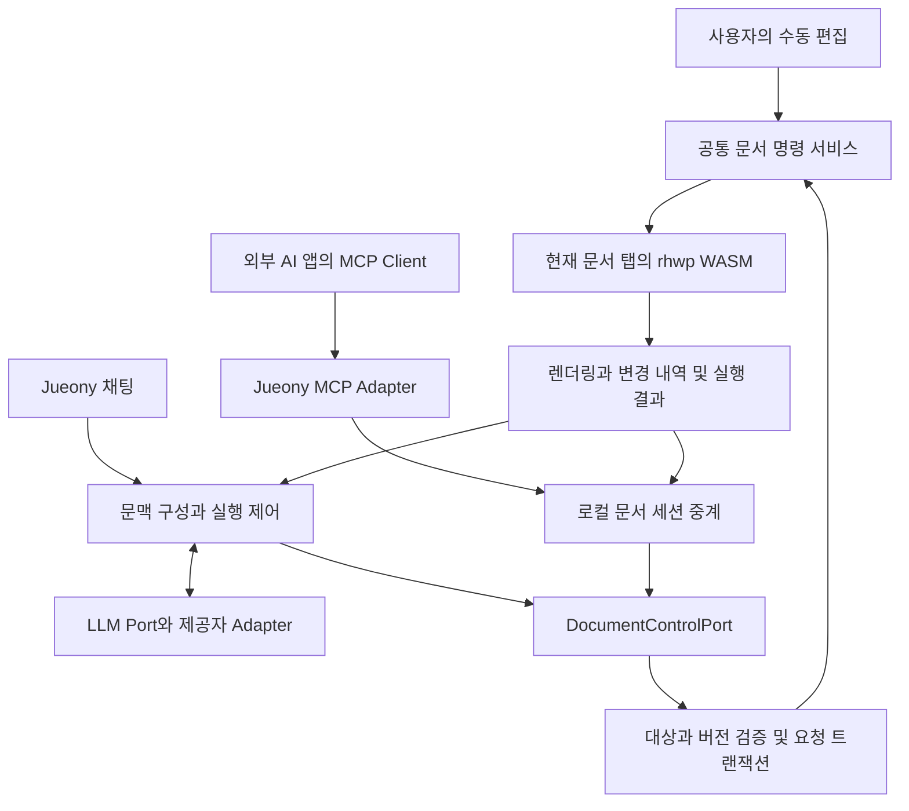

# Jueony 전체 편집 기능의 AI 제어 작업 계획

작성일: 2026-10-11  
기준: Jueony `3baf1e8`, rhwp `1a76570e833917d15817415a53c09ad61ab3203f`, `@rhwp/core@0.8.7`  
상태: **2026-10-11 후속 사용자 지시로 구현 착수. 완료 여부는 기능별 검증 결과로 관리한다.**

1차 구현과 첫 복합 과제의 결과는 [17번 기록](17-editor-control-implementation.md)에 정리했다. C01/C03/C05/C06/C07/C11의 일부와 단축키 기반을 연결했다. 외부 MCP·개체·고급 표 등 전체 계획은 진행 중이며 완료로 표시하지 않는다.

사용자가 채팅으로 요청하면 AI가 화면에 열린 문서의 내용·구조·서식·표·개체·쪽 설정을 직접 읽고 편집하도록 확장한다. 변경은 같은 문서 엔진과 undo 이력을 사용하며, 사용자도 곧바로 이어서 편집한다. 개별 문단 선택과 매번 승인하는 절차를 기본 흐름으로 만들지 않는다.

개발 대상은 **공통 문서 제어 API, 이를 사용하는 Agent, 외부 AI 앱을 연결하는 MCP 서버**다. 먼저 내부 제어 API를 완성하고 기능군별로 연결한다. MCP는 이 API를 외부에 제공하는 표준 연결 계층이다. MCP 서버 설치만으로 편집 기능이나 파일 호환성이 추가되지는 않는다.

[기능별 작업 목록](ai-editor-capability-matrix.csv)을 이 계획과 함께 관리한다. 기본 편집기 품질은 [10번 계획](10-basic-editor-work-plan.md), 업무·채팅은 [11번 계획](11-workspace-agent-mvp-plan.md), 현재 구현 상태는 [12번 문서](12-mvp-implementation.md), 제공자 연결은 [13번 명세](13-llm-provider-adapters.md)를 따른다.

## 1. 전체 기능의 의미와 완료 범위

목표는 Jueony에서 제공하는 문서 기능을 사용자가 직접 실행하거나 AI 명령으로 실행할 수 있게 하는 것이다. 기능마다 조회·생성·수정·이동·삭제 중 해당하는 동작과 비교·undo·저장까지 연결한다. 버튼 이름만 도구 목록에 올리거나 대화상자만 여는 상태는 AI 지원으로 인정하지 않는다.

다음 세 범위를 구분한다.

| 범위 | 해야 할 일 | 완료 판단 |
| --- | --- | --- |
| 현재 Jueony의 실제 편집 기능 | 기존 명령·서비스를 재사용해 구조화된 인자로 호출 | 내부 Agent와 공통 API에서 실제 반영·undo·저장 검증 |
| 엔진에는 후보 API가 있으나 앱에서 연결하지 않은 기능 | API 동작과 보존 가능성을 검증한 뒤 편집기와 AI에 연결 | 수동/AI 경로의 결과가 일치하고 형식별 재열기 통과 |
| 한글 2024에는 있으나 현재 엔진에 없거나 불완전한 기능 | 누락을 기능 목록에 등록하고 엔진·UI·명령·검증을 함께 개발 | 미구현 표기를 없애려면 실제 동작과 독립 호환성 증거 필요 |

한글 2024의 메뉴·리본·대화상자·단축키 목록과 현재 Jueony 목록을 대조하는 작업을 C00에 포함한다. 첨부 CSV는 초기 목록이며 한글 전체 기능을 빠짐없이 실사한 결과는 아니다. 누락 기능을 찾아 목록을 확정하기 전에는 “모든 기능 지원”이라고 표시하지 않는다. **AI 제어 범위와 한글 파일 호환성은 별개의 완료 지표**다.

문서 기능에는 파일·템플릿·본문·서식·표·그림·도형·글상자·수식·쪽/구역·머리말/꼬리말·각주·필드·책갈피·검토·인쇄·복구를 포함한다. 차트, 변경 추적, 차례, 메일 머지, OLE 등 확인이 필요한 기능도 후속 목록에 남긴다. 엔진이 지원하지 않는 기능을 영구 제외하여 완료율을 높이지 않는다.

업무/채팅/참고 자료 관리는 문서 편집과 별도 권한의 앱 제어로 연결한다. API 키 조회, 보안 정책 변경, 임의 프로그램 실행, 원본 자료의 무단 이동·삭제는 문서 편집 도구에 포함하지 않는다. 인쇄·파일 선택처럼 OS의 사용자 조작이 필요한 기능은 요청 생성과 실제 완료를 구분한다.

## 2. 현재 코드에서 확인한 출발점

아래의 “후보”는 소스에 명령 또는 API가 있다는 뜻이다. 기능 전체의 실행 성공이나 HWP/HWPX 보존을 보증하지 않는다.

| 영역 | 확인된 상태 | 재사용과 추가 작업 |
| --- | --- | --- |
| AI 본문 편집 | `EditOp`는 새 문서, 본문 문단 삽입, 텍스트 교체, 텍스트 삭제 4종 | 기존 실행·검증을 공통 제어 API로 옮기고 구조 명령 추가 |
| 문서 문맥 | 본문 중심 `Snapshot`, `s{section}p{paragraph}` 위치 ID, 일부 제약 및 텍스트 상한 | 셀·개체·구역 등 구조 조회, 위치가 바뀌어도 대상을 구분하는 규칙 필요 |
| 동시 편집 | 문서 revision 검사, 적용 중 입력 제한, IME 조합 가드 | 서식/개체/구역 변경도 revision에 반영되는지 검증 |
| 요청 undo | snapshot 이력과 요청 ID를 사용하며 최신 요청인지 검사 | 구조·자산·쪽 설정의 비교/복구, 재연결 시 중복 실행 방지 확장 |
| 비교와 실패 판단 | 결과 비교는 본문 중심이며 실패 확인에 HWP export 바이트도 사용 | 원본 형식별 snapshot, 구조·속성·자산 검증; 표/서식의 성공을 텍스트로만 판정하지 않음 |
| Studio 자동화 | `listCommands`, `isEnabled`, `execute`; 일부 명령은 `needs-dialog` | 대화상자의 적용 로직을 인자 기반 서비스로 분리; 완료와 오류를 반환 |
| 표/서식/쪽/개체 | 명령 모듈과 다수 WASM API 존재 | 실제 호출·컨텍스트·저장 범위를 확인하여 기능군별 연결 |
| 표 제한 | `localTableGeometryCanPersist()`가 `false`인 보존 제한 존재 | 제한된 기하 편집은 엔진 저장 지원부터 해결; AI에서 강제 활성화 금지 |
| HwpCtrl 호환 계층 | executor 없는 stub도 등록됨; 현재 빌드는 `__RHWP_HWPCTRL__: false` | Action 이름 개수를 구현 개수로 세지 않음; 검증된 executor만 재사용 후보 |
| HCX-005 연결 | 문단 단위 함수 호출 계약과 원문 검증을 내부 명령으로 변환 | 새 중립 명령 목록을 모델별 schema로 표현; 본문 전용 prompt/schema 교체 |
| 로컬 서버 | Node가 파일 제공·LLM proxy·설정을 담당 | 열린 브라우저 엔진을 호출할 세션 중계는 별도 구현 필요 |
| upstream MCP | Rust `mcp-serve`, stdio, 세션 조회·편집·저장 및 계약 테스트 존재 | 도구 정의·오류·테스트 참고. 디스크를 읽어 별도 `HwpDocument`를 만드는 경로는 열린 편집기 제어와 구분 |

### 근거 코드

- 자체 계약과 실행: [model.ts](../apps/editor/src/mvp/model.ts), [editor-bridge.ts](../apps/editor/src/mvp/editor-bridge.ts), [run-once.ts](../apps/editor/src/mvp/run-once.ts), [desktop-host.ts](../apps/editor/src/desktop-host.ts).
- 화면·빌드: [chrome-2024.ts](../apps/editor/src/chrome-2024.ts), [build.mjs](../apps/editor/scripts/build.mjs). `.build/studio`는 생성물이므로 수정 원본으로 사용하지 않는다.
- 제공자·서버: [paragraph-contract.mjs](../apps/launcher/providers/paragraph-contract.mjs), [server.mjs](../apps/launcher/server.mjs).
- 고정 upstream 소스: [AutomationHost](https://github.com/edwardkim/rhwp/blob/1a76570e833917d15817415a53c09ad61ab3203f/rhwp-studio/src/automation/host.ts), [명령 모듈](https://github.com/edwardkim/rhwp/tree/1a76570e833917d15817415a53c09ad61ab3203f/rhwp-studio/src/command/commands), [HwpCtrl registry](https://github.com/edwardkim/rhwp/blob/1a76570e833917d15817415a53c09ad61ab3203f/rhwp-studio/src/hwpctl/action-registry.ts), [Rust MCP 서버](https://github.com/edwardkim/rhwp/blob/1a76570e833917d15817415a53c09ad61ab3203f/src/mcp_serve.rs), [MCP 도구 정의](https://github.com/edwardkim/rhwp/tree/1a76570e833917d15817415a53c09ad61ab3203f/src/cli/metadata/mcp).
- 설치된 `apps/editor/node_modules/@rhwp/core/rhwp.d.ts`의 `setCharShapeRuns`, `setParaShapeId`, `insertTableRow`, `mergeTableCells`, `setCellShapePropertiesByPath`, `setPageDef`, `createHeaderFooter`, `insertFootnote`, `setShapeProperties`, `insertEquation` 등은 후보 API다. 설치된 WASM과 해당 선언의 실제 일치를 기능 검사에서 확인한다.

## 3. 공통 제어 API와 MCP의 연결 구조

MCP 서버는 AI 앱에 도구와 자료를 표준 방식으로 제공한다. 모델 선택·문맥 구성·계획 실행은 Jueony Agent의 책임으로 유지한다. 내부 Agent는 공통 API를 직접 사용할 수 있으며, 내부 편집을 위해 MCP 통신을 강제하지 않는다. [MCP 공식 구조 설명](https://modelcontextprotocol.io/docs/2026-07-28/learn/architecture).

제안하는 코드 배치는 다음과 같다. 기존 코드를 이동할 때 호환 wrapper를 유지하여 현재 MVP를 깨뜨리지 않는다.

| 책임 | 제안 위치 | 재사용 기준 |
| --- | --- | --- |
| 명령 타입·schema·capability registry | `packages/document-control/` | 브라우저와 Node가 공유; provider/DOM/WASM 의존성 없음 |
| 현재 문서 조회·명령 적용 adapter | `apps/editor/src/document-control/` | 기존 `mvp/editor-bridge.ts`, Studio 명령·input handler 재사용 |
| 문맥 구성·실행 정책 | `apps/editor/src/mvp/`의 기존 Agent 확장 | 현재 `run-once` 보존; 선택적 제한 loop는 별도 실행 정책 |
| 앱 세션 중계 | `apps/launcher/document-sessions/` | Node와 renderer 연결; 문서 내용을 독립 파싱하여 소유하지 않음 |
| MCP 입출력 변환 | `apps/mcp/` | 공통 registry와 세션 중계 호출; 편집 로직 중복 구현 금지 |
| 엔진에 없는 기능 | 관리 가능한 rhwp 패치 또는 fork | Rust 수정·WASM 재빌드·독립 검증·제3자 고지 함께 유지 |

작은 공통 계약과 실제 adapter부터 만든다. 빈 플러그인 프레임워크는 만들지 않는다. Rust는 문서 엔진 보강에 사용하고 현재 동작하는 TypeScript UI/Agent와 Node 서버는 재사용한다. MCP의 구현 언어는 필수 조건이 아니며, 초기 연결 계층은 현재 런타임과 계약을 공유하기 쉬운 TypeScript를 기본안으로 한다.

upstream Rust MCP는 파일 기반 배치 처리의 별도 활용 후보로 남긴다. **화면에서 편집 중인 파일을 그 서버가 다시 열어 저장하게 연결하지 않는다.** Node/MCP가 살아 있어도 해당 renderer가 연결되지 않았다면 `document_unavailable`을 반환한다. renderer 종료 시 디스크 편집으로 자동 전환하지 않는다.

## 4. 문서 조회와 명령 계약

### 문서와 대상의 식별

모든 요청은 `workspaceId`, `documentSessionId`, `documentId`, `expectedRevision`, `requestId`를 가진다. 활성 탭이나 커서 위치만으로 쓰기 대상을 결정하지 않는다. 탭 전환·파일 재열기·앱 재시작은 세션 세대를 구분하며 오래된 ID는 거부한다. 이 문서 세션은 MCP 전송 연결의 세션과 별개다.

조회는 본문, 구역, 문단, 글자 run, 표/셀, 개체, 머리말/꼬리말, 각주/미주, 필드의 계층과 속성을 반환한다. 각 항목에 `nodeId`, 종류, 컨테이너, 읽기/편집 가능 범위, 제한 이유를 붙인다. 미지원 개체도 존재와 보존 상태를 표시한다. 텍스트가 없다는 이유로 없는 개체로 취급하지 않는다.

현재 위치 기반 ID는 문단 삽입·이동 후 바뀔 수 있다. C01에서 다음 규칙을 구현한다.

- 세션 안에서 유지되는 ID와 엔진 경로의 대응표를 관리하고 구조 변경 뒤 재매핑한다. 엔진이 안정적 식별을 보장하지 못하면 revision에 묶인 핸들을 무효화하고 재조회하게 한다.
- 동일 batch의 기존 대상은 변경 전 상태에서 해석하고, 앞선 명령으로 생성한 항목은 `resultRef`로 참조한다. 명령마다 변하는 배열 번호를 그대로 재사용하지 않는다.
- 중복 문구·중첩 표·병합 셀·머리말의 상속 범위를 구분한다. “두 번째 항목”이 모호하면 추측 적용 대신 구체적 대상 선택 또는 재조회 결과를 반환한다.
- 텍스트 범위의 Unicode 기준을 하나로 정하고 모델이 한국어/이모지 offset을 직접 계산하지 않도록 원문·anchor 기반 명령을 우선 제공한다.

### 읽기와 변경의 공통 결과

계획상의 API는 `listCapabilities`, `getDocument`, `readNodes`, `search`, `getSelection`, `previewPages`, `applyBatch`, `getReceipt`, `undoRequest`, `saveDocument`다. 실제 외부 도구 이름은 C13에서 확정한다.

`getDocument`는 전체 구조 요약과 revision을 반환하고, 긴 문서는 `readNodes`로 필요한 영역을 나누어 읽는다. 각 응답에 읽은 범위, `complete`, 다음 cursor, 잘림/미지원 이유를 제공한다. 여러 번의 조회 도중 revision이 바뀌면 문맥을 혼합하지 않고 다시 읽는다. 전체 문서를 탐색할 수 있어야 하지만 매 요청에 전체 바이트나 모든 이미지가 모델에 전달될 필요는 없다.

명령 registry에는 입력/출력 schema, 적용 가능한 노드, 형식별 지원, read-only 여부, undo 가능 여부, 필수 사전 조건, 검사 함수를 등록한다. UI의 가능 여부와 Agent/MCP 도구 목록이 이 registry를 공유한다. 서식 단위는 `mm`, `pt`, 줄 간격 방식 등을 명시하며 생략된 속성은 기존 값을 보존한다. 색상·enum·숫자 범위·글꼴 존재·용지 방향과 크기의 충돌을 검증한다.

`applyBatch`의 결과에는 실제 적용 수, 생성한 ID, 변경한 노드/속성, 전후 revision, 구조 diff, 경고, undo 참조를 넣는다. 제안된 명령을 실제 실행 결과처럼 채팅에 표시하지 않는다. 반환 상태는 최소한 `applied`, `no_change`, `conflict`, `cancelled`, `rolled_back`, `partial`, `unsupported`, `needs_user_action`, `outcome_unknown`을 구분한다.

### 요청 단위 적용과 되돌리기

1. capability·문서/업무·대상·모든 인자를 검증하고 batch 의존 관계를 해석한다.
2. 실제 변경 직전에 revision을 재검사한다. 문서별로 수동 명령과 AI/MCP 쓰기를 직렬화하고 IME 조합을 보호한다.
3. 원본 형식과 자산을 보존하는 snapshot 또는 검증된 역명령으로 복구 지점을 만든다.
4. 공통 명령 서비스에서 실행한다. 대화상자 열기나 이벤트 dispatch만으로 성공 처리하지 않는다.
5. 엔진 속성·구조, 렌더 완료, 예상 결과를 확인하고 한 요청의 history와 receipt를 기록한다.
6. 실패하면 복구를 검증한다. 복구되지 않으면 적용된 항목을 표시하고 추가 쓰기를 막은 뒤 복구 경로를 제공한다.

초기에는 복구가 검증된 명령끼리만 원자적 batch를 허용한다. 파일 저장·인쇄 같은 외부 부수 효과는 문서 트랜잭션 뒤 별도 단계로 실행한다. MCP 자체가 여러 도구 호출의 원자성을 보장한다고 가정하지 않는다. 새 문서 탭 생성·취소·닫기는 내용 undo와 구분하여 원래 탭과 미저장 내용을 보존한다.

요청 ID와 payload hash로 중복 실행을 막는다. 같은 ID에 다른 요청은 거부한다. 연결이 끊겨 응답이 유실되면 receipt 조회로 결과를 확인하고, 확인할 수 없으면 재실행을 멈춘다. 재시작 후 자동 재적용하지 않는다. 긴 편집은 원자적 작업 경계에서 취소하고 취소 시점의 변경 여부를 반환한다.

undo는 본문뿐 아니라 표 구조, 서식, 자산, 구역·쪽 설정을 복원해야 한다. 요청 이후 사용자가 편집했을 때 최신 내용을 덮어쓰는 snapshot 복원은 거부한다. 초기에는 순서에 맞는 undo만 허용하고 이유를 설명한다. 임의 과거 요청만 선택적으로 되돌리는 기능은 별도의 충돌 해결 작업으로 다룬다.

## 5. 기능군별 구현 내용

세부 항목과 검사 연결은 [기능 목록 CSV](ai-editor-capability-matrix.csv)에 둔다. 아래 기능은 모두 계획 범위이며 단계별 실제 지원 상태를 별도로 공개한다.

| 기능군 | 읽기와 AI 편집 동작 | 반드시 확인할 보존 조건 |
| --- | --- | --- |
| 파일·문서 | 새 문서/템플릿, 열기·전환·닫기, 저장·다른 이름/형식, 복구 | 탭별 소유권, 미저장 내용, 외부 파일 변경, 저장 확인 |
| 본문·구조 | 삽입·교체·삭제, 문단 분리/합치기/이동, 여러 위치 수정, 찾기/바꾸기 | 혼합 서식, 제어문자·필드 경계, 문단/구역 경계, 한국어·이모지 |
| 글자·문단·스타일 | 글꼴·크기·색·굵기·밑줄·장평·자간, 정렬·여백·들여쓰기·줄 간격, 탭, 스타일 생성/수정/적용, 번호·글머리표 | 범위 밖 속성, 상속과 직접 서식, 번호 재시작·수준 |
| 표 | 생성/삭제/이동, 셀 읽기·채우기, 행/열 삽입·삭제·크기, 병합/분할, 셀 서식·테두리·배경·정렬, 표 제목/반복·쪽 넘김, 중첩 표·계산 | 셀 손실, 병합 영역, 중첩 경로, 컨트롤 보존, 형식별 저장 제한 |
| 그림·도형·글상자 | 로컬 자산 삽입/교체, 크기·위치·배치·자르기·회전, 선/채우기, 그룹·순서·캡션, 글상자 내용/서식 | 자산 bytes, anchor, 종횡비, 겹침·감싸기, 그룹/좌표계 |
| 수식·고급 개체 | 수식 내용/속성, 차트/OLE 등 개체별 읽기·편집 가능성 | 원본 데이터 보존; 엔진 미지원은 별도 구현으로 등록 |
| 쪽·구역 | 용지/방향/여백, 구역 생성/설정, 다단, 쪽/단 나누기, 쪽 테두리·배경 | 특정 구역에만 적용, 텍스트 reflow, 번호와 개체 위치 |
| 머리말·주석·필드 | 머리말/꼬리말, 쪽 번호·전체 쪽 수, 각주/미주, 책갈피·링크·누름틀·양식 필드 | 홀짝/첫 쪽, 구역 상속, 계산 필드와 일반 문자열의 구분 |
| 검토·자동 작성 | 메모, 변경 추적, 문서 비교, 차례/목차/색인, 맞춤법·메일 머지 | 엔진 보존과 UI 확인, 외부 사전·서비스 의존성 표시 |
| 보기·출력·기록 | 선택/이동/확대·축소/조판 부호, 미리보기, 인쇄/PDF, undo/redo·자동 복구 | 문서 변경과 보기 변경 구분; OS 완료 확인과 dirty 정합성 |
| 문서 보호·앱 기능 | 읽기 전용/보호 상태 조회, 지원 가능한 암호화·서명 절차, workspace/참고 자료 지정 | 비밀 전달은 전용 UI, 정책 우회 금지, 업무 간 격리 |

엔진 함수가 예외를 삼키거나 상태를 반환하지 않는 경우 wrapper에서 후조건을 검증하고 오류 경로를 보강한다. 특히 표 명령의 일부 catch/log 처리와 `execute(): void`는 Agent의 신뢰할 수 있는 성공 결과로 곧바로 사용하지 않는다.

## 6. Agent와 제공자 확장

첫 단계는 현재의 **문맥 구성 → 모델 한 번 호출 → 명령 batch 검증 → 적용 → 결과 표시**를 유지한다. 새 표의 ID가 필요한 후속 셀 채우기·서식 명령은 batch의 `resultRef`로 해결한다. 첫 표 편집 기능을 위해 자율 loop나 RAG를 선행 개발하지 않는다.

기능이 넓어지면 C12에서 제한된 `조회 → 판단 → 실행 → 확인` 정책을 추가한다. 최대 모델 호출 수·도구 실행 수·시간·출력량을 설정하고 중단/실패/취소 이유를 기록한다. 먼저 읽기 도구로 필요한 문맥을 확보한 뒤 하나의 변경 batch를 구성한다. 여러 batch가 필요한 실행은 각각의 적용·undo 범위를 표시하며 요청 전체가 원자적이라고 주장하지 않는다.

LLM Port와 GPT·Claude·Gemini·HyperCLOVA X adapter는 기존 분리를 유지한다. capability registry에서 실제 가능한 명령만 모델에 제공하고, 모델별 JSON Schema/function calling 표현 차이만 adapter에서 변환한다. HCX-005의 본문 전용 계약, HCX-007/호환 adapter의 기존 schema를 함께 갱신한다. 모델이 새 schema를 지원하지 않으면 해당 연결의 사용 가능한 기능을 제한하여 표시한다.

참고 문서와 편집 중인 본문은 자료로 다룬다. 그 안의 “다른 파일 삭제”, “인증 키 표시” 같은 문자열로 도구 권한을 확대하지 않는다. 실행 권한은 사용자의 요청과 앱 설정에서 온다. RAG는 향후 Context 공급원이며 이 계획의 필수 선행 조건이 아니다.

## 7. MCP 서버 구현 범위

외부 AI 앱이 현재 Jueony의 문서를 읽고 제어할 필요가 있을 때 MCP adapter를 연결한다. 초기 도구군은 세션 목록, capability 조회, 문서/노드 읽기·검색, batch 적용, receipt 조회, undo, 저장으로 제한한다. 표·서식 등의 상세 명령은 같은 registry의 검증된 schema를 사용한다. 임의 JavaScript, raw WASM 호출, DOM selector 실행 도구는 제공하지 않는다.

MCP 도구는 입력/출력 schema와 구조화된 결과를 제공한다. 도구 annotation은 설명용이며 앱의 권한 검사와 사전 조건을 대체하지 않는다. [MCP 도구 명세](https://modelcontextprotocol.io/specification/2026-07-28/server/tools).

로컬 배포의 초기 기본안은 **stdio MCP 프로세스 → 인증된 로컬 중계 → 현재 renderer**다. stdio 프로세스를 띄우는 것만으로 브라우저의 `window.jueonyEditor`에 접근할 수는 없으므로 C02의 연결이 필요하다. Streamable HTTP는 대상 클라이언트에 필요할 때 추가하고, 선택한 transport와 지원 protocol/SDK 버전을 고정해 검사한다. [MCP 전송 명세](https://modelcontextprotocol.io/specification/2026-07-28/basic/transports).

고정 upstream Rust 서버는 현재 `2025-06-18` 한 버전을 명시한다. 이를 최신 MCP 클라이언트와 자동 호환한다고 가정하지 않는다. C13에서 실제 대상 클라이언트, 협상/발견 방식, SDK 지원 버전을 확인한다. 앱의 문서 세션 수명·버전 규칙은 어떤 MCP 개정판을 선택하더라도 공통 API에 남긴다.

세션 중계와 외부 연결의 구현 조건은 다음과 같다.

- 앱 인스턴스/renderer/업무/문서의 연결을 인증하고, 같은 origin의 잘못된 iframe이나 다른 탭으로 명령이 전달되지 않게 한다.
- renderer가 준비될 때 등록하고 닫힘·재시작·heartbeat 만료 때 해제한다. 중계는 실제 실행 완료 응답을 기다리며 전달 성공과 편집 성공을 구분한다.
- 초기 외부 연결은 사용자가 켠 로컬 연결만 허용한다. 연결별 업무·문서·읽기/쓰기 범위를 선택하고 UI에 연결/실행 상태와 중지 기능을 둔다. 기존 승인 범위 내에서 매 명령마다 확인창을 띄우지 않는다.
- 웹 중계는 loopback 바인딩, Host/Origin 검사, 인스턴스 토큰과 연결 수명 검사를 적용한다. 기존 브라우저 인증 경로에 외부 클라이언트를 무인증으로 끼워 넣지 않는다.
- MCP 호출자는 Jueony의 LLM API 키를 읽을 필요가 없다. 비밀은 도구 목록/결과/로그에 포함하지 않는다. 문서 읽기 권한은 외부 AI 앱에 전달될 문서 범위와 일치해야 한다.
- 승인된 파일/폴더 핸들과 자산 ID를 사용한다. 임의 경로·외부 URL로 모델이 파일 접근 범위를 넓히지 못하게 한다.
- MCP 연결이 없어도 Jueony의 로컬 편집·내부 AI 연결은 계속 작동한다. 외부 클라이언트 미설치로 내부 기능 개발을 중단하지 않는다.

## 8. 단계별 작업과 완료 조건

작업 목록 작성 시 상태는 **미착수**였으며 후속 지시로 구현을 시작했다. 기존 구현은 재사용 출발점이며 아래 확장 작업의 완료를 뜻하지 않는다. 행의 수용 검사 ID는 10절과 연결된다.

| 작업 | 구체적인 산출물 | 선행 | 완료 조건 |
| --- | --- | --- | --- |
| C00 기능 실사 | UI command·dialog·HwpCtrl executor·WASM·한글 2024 대조 목록; CSV 누락 보완 | 없음 | stub/미지원/보존만 가능/검증 완료를 구분; 모든 메뉴에 기능 ID 연결; A01 |
| C01 공통 계약과 구조 조회 | registry, typed schema, 구조 snapshot, ID/path 대응, 범위 조회·검색·페이지 preview | C00 | 미저장 문서의 표·개체·구역 조회, 잘림·revision 명시; A02~A05 |
| C02 현재 세션 연결 | 탭/renderer 등록과 수명, 현재 엔진 adapter, Node 세션 중계 | C01 | 다른 업무·탭·재연결 대상 오편집 차단; A06~A07 |
| C03 트랜잭션과 history | batch 사전 검사·의존 참조·snapshot·구조 diff·receipt·undo·재실행 방지 | C01, 현재 adapter | 원자성/부분 실패/취소/중복/후속 사용자 편집 검사; A08~A12 |
| C04 본문과 구조 | 여러 컨테이너의 범위 편집, 문단 분리/합치기/이동, 찾기/바꾸기 | C03 | 혼합 서식·필드 보호, 위치 이동과 Unicode 검사; A13 |
| C05 서식과 스타일 | 글자/문단 속성, 스타일·탭·목록, dialog apply 로직 서비스 분리 | C03 | 지정 범위만 변경, 스타일 상속·undo·저장; A14 |
| C06 표 전체 제어 | 표/셀 경로 조회, 생성·채움·행열·병합/분할·서식·배치·계산 | C03, C05 | 기본 표부터 중첩/병합 표까지 기능별 fixture와 형식별 검증; A15~A16 |
| C07 쪽과 구역 | 용지/여백/방향, 다단·구역·쪽 나눔, 머리말/꼬리말·쪽 번호 | C03 | 구역별·홀짝·상속·reflow·저장 검사; A17 |
| C08 개체와 자산 | 이미지/도형/글상자/수식의 CRUD·배치·속성, 로컬 자산 resolver | C03, C05 | 자산 보존, 위치/감싸기/그룹·undo·재열기; A18 |
| C09 필드와 검토 기능 | 각주/미주·링크/책갈피·양식·메모·변경 추적·차례 | C04, C07 | 필드 구조와 참조 보존; 엔진 부족분은 C16에 연결; A19 |
| C10 파일과 앱 명령 | 문서 생명주기·템플릿·형식별 저장/복구·인쇄, 보기·workspace/자료 제어 | C02, C03 | 저장 확인·외부 변경·권한·출력·업무 격리; A20~A23 |
| C11 내부 AI 명령 확장 | 공통 도구 schema, provider별 변환, 한 번 호출하는 batch, 변경 결과 UI | C01, C03, 대상 기능 | 실제 HCX-005로 표·서식·쪽 설정 반영; 미지원/허위 성공 없음; A24~A25 |
| C12 제한된 실행 제어 | 필요한 영역 추가 조회, 도구 결과 반영, 호출/시간 한도·중지 | C11 | 끝나지 않는 반복·중복 적용 차단, 실패 원인/부분 결과 표시; A26 |
| C13 MCP adapter | 도구/자료 노출, stdio entry, 연결 설정·오류·권한·protocol 검사 | C02, C03, 대상 기능 | 실제 외부 클라이언트가 같은 미저장 문서를 제어; A27~A28 |
| C14 통합 품질과 한글 검수 | 명령/모델/E2E 회귀, 합성 원본·적용본·undo본, 한글 2024 비교 묶음 | 출시 대상 기능 | HWP/HWPX 기능별 결과·보존·호환성 증거; A29~A30 |
| C15 사용자 안내와 배포 정리 | 실제 capability 화면, 설정/연결/중지/복구 안내, 오프라인 자산·license 확인 | C11, C13, C14 | 지원 범위와 실행 결과 일치, 키 없이 재현 가능한 실행 묶음; A31 |
| C16 엔진 누락 보강 | C00/C06~C10의 부족 기능별 Rust·WASM·UI 작업과 회귀 fixture | 해당 기능 실사 | 필요한 기능을 실제 구현하고 공통 API/저장/한글 검수까지 통과; A32 |

C16은 마지막까지 미뤄 놓는 한 작업이 아니다. 각 기능에서 막히는 즉시 독립 하위 작업으로 만들고 해당 기능의 후속 연결 전에 완료한다. 엔진을 바꾸면 변경한 소스에서 WASM을 빌드해야 하며 기존 npm WASM 테스트 결과를 새 엔진 검증으로 사용하지 않는다.

### 구현 순서

1. **기반:** C00 → C01 → 현재 renderer adapter와 C03. C02의 외부 중계는 내부 첫 기능을 막지 않도록 분리한다.
2. **첫 완주:** C05 기본 서식 + C06 기본 표 + C07 기본 용지 + C11 단일 호출 + C10 저장/undo 연결. 9절의 시나리오를 먼저 통과한다.
3. **편집 범위 확장:** C04~C10의 나머지를 기능군별로 검증하고 C16 부족분을 해결한다. C12의 추가 읽기 흐름을 연결한다.
4. **외부 AI 연결:** C02 중계와 C13을 완성해 내부/외부 결과가 같은지 검사한다. 첫 완주 기능부터 MCP에 노출하고 나머지는 검증 후 순차 노출한다.
5. **기능 목록 닫기:** C14/C15와 함께 미구현·실패·미검수 항목을 추적한다. 미완료 항목이 남으면 해당 단계의 출시 범위를 명시한다.

기능군 하나를 추가할 때 조회 → 구조화 명령 → 엔진 반영 → diff → undo → HWP/HWPX 저장/재열기 → 모델 호출 순서로 끝까지 연결한다. 도구 선언을 한꺼번에 추가해 구현된 것처럼 노출하지 않는다.

## 9. 첫 번째 구현 검증 과제

첫 목표는 “기존 본문 문서에 표를 넣고 서식과 쪽 설정을 바꾸는 요청”이다. 파일 두 형식으로 동일하게 검증한다.

> 현재 문서의 ‘추진 일정’ 문단 뒤에 4행 3열 표를 넣어줘. 첫 행은 ‘단계 / 기간 / 담당’, 나머지는 ‘준비 / 1월 / 총무’, ‘실행 / 2월 / 사업’, ‘점검 / 3월 / 감사’로 채워줘. 표 머리행을 굵게 하고 배경을 연한 회색으로 바꿔줘. ‘추진 일정’ 제목은 16pt 굵게 하고, 이 문단이 속한 구역을 A4 가로·상하좌우 여백 20mm로 바꿔줘.

검증 절차:

1. 합성 HWP/HWPX를 열어 사용자가 본문을 수정하고 저장하지 않는다. 섹션·표·다른 개체가 있는 원본은 별도 fixture로 둔다.
2. 결정적인 명령 fixture로 새 표의 `resultRef`, 셀 값, 범위 서식, 구역 설정을 한 batch에 적용한다. 앞선 수동 수정은 유지한다.
3. 구조 조회와 화면에서 4×3 표·12개 셀 값·머리행 속성·제목 속성·해당 구역의 용지/여백을 확인한다. 다른 구역은 바뀌지 않아야 한다.
4. 한 번 되돌려 본문·표·서식·용지·자산이 적용 직전으로 복구되는지 확인한다. 다시 적용하고 수동 셀 입력이 가능한지 확인한다.
5. 위 명령이 실제 지원 목록에 올라온 뒤 HCX-005로 같은 요청을 실행한다. 명령 검증 성공과 요청 내용 충족을 별도로 채점한다.
6. 사용자 저장 동작으로 사본을 만들고 Jueony에서 재열기한다. 원본·적용본·되돌림본·변경 요약·화면을 한글 2024 검수용으로 준비한다.
7. 생성 중 수동 편집, 두 번째 명령 실패, 저장 취소를 주입하여 충돌·rollback·dirty 표시를 검사한다.

실제 한글이 없으면 독립 검수만 `검수 대기`로 남기고 가능한 구현·검증은 계속한다. 외부 MCP 연결은 이 첫 과제의 선행 조건이 아니다.

## 10. 수용 검사

다음은 **검사 명세이며 실행 결과가 아니다.** 실행 시 commit, OS/브라우저, 엔진/WASM 버전과 해시, provider/model, 입력/출력 형식, fixture, 기대/실제 결과, 증거 위치를 기록한다. 모델 호출 검사에는 합성 자료를 사용한다.

| ID | 검사와 기대 결과 |
| --- | --- |
| A01 | 현재 UI·command·dialog·engine·한글 대조: stub를 지원으로 광고하지 않고 모든 기능에 상태/작업 연결 |
| A02 | 저장하지 않은 본문·표·개체·구역·필드 조회: 화면과 동일한 revision 및 구조 |
| A03 | 긴 문서 나눠 읽기·중간 수정: 잘림을 공개하고 서로 다른 revision 문맥 혼합 없음 |
| A04 | 앞 문단 삽입/이동, 중복 문구, 중첩 표, 새 표 resultRef: 의도한 대상만 변경 |
| A05 | 잘못된 인자/단위/노드 종류/없는 글꼴/미지원 기능: 구체적 오류, 변경 0 |
| A06 | 업무·탭·renderer·파일 재열기 전환: 원래 세션 외 쓰기 차단 |
| A07 | 연결 종료·앱 재시작·동시 외부 클라이언트: 문서별 직렬 실행, 닫힌 엔진으로 적용 없음 |
| A08 | 모델 생성 중 수동 본문/서식/쪽 설정 변경·IME 조합: 오래된 batch 충돌, 조합 손상 없음 |
| A09 | 두 번째 명령/렌더/복구 실패 주입: no_change/rolled_back/partial 정확히 구분 |
| A10 | 같은 requestId 재전송·다른 payload·응답 유실: 중복 적용 없음, receipt 또는 결과 불명확 표시 |
| A11 | 표·서식·개체·쪽 설정의 요청 undo/redo: 구조와 자산까지 복원, 후속 수동 입력 덮어쓰기 없음 |
| A12 | 생성 전/적용 중 취소·새 문서 생성 실패: 원래 탭 보존, 실제 적용 범위 안내 |
| A13 | 혼합 run·필드 경계·문단 이동·찾아 바꾸기·한국어/이모지: 텍스트와 비대상 서식 보존 |
| A14 | 글자/문단/스타일·번호/글머리표·탭 설정: 상속·범위·값 일치, undo와 재열기 통과 |
| A15 | 표 생성/셀 채움/행열 삽입삭제/병합분할/서식: 셀 내용 손실·다른 표 변경 없음 |
| A16 | 중첩/병합 표·반복 제목·쪽 넘김·폭/높이·계산: 엔진과 저장의 실제 지원 범위 검증 |
| A17 | 여러 구역의 방향/여백/다단·머리말·홀짝·번호·각주 배치: 지정 범위와 상속 일치 |
| A18 | 이미지/도형/글상자/수식 생성·수정·삭제·그룹/배치: 자산 hash와 위치/속성 보존 |
| A19 | 필드/책갈피/링크/주석·검토·차례: 문자열만 바뀐 가짜 구현 없이 구조와 참조 검증 |
| A20 | 새 문서/템플릿/열기/전환/닫기·미저장 경고: 다른 문서 상태와 파일 보존 |
| A21 | HWP/HWPX 저장·다른 이름·외부 수정·쓰기 실패·다운로드 취소: 저장 성공 및 dirty 정확 |
| A22 | 미리보기/PDF/인쇄·복구·확대/축소: 출력 대상 일치, 대화상자/실제 출력 결과 구분 |
| A23 | workspace/자료 선택과 악성 문서 지시: 업무 격리, 원본 자료·키·허용 경로 보호 |
| A24 | 결정적 응답과 실제 HCX-005로 첫 과제: 명령 성공뿐 아니라 표 내용·서식·쪽 요구 충족 |
| A25 | provider/model schema 차이, 잘못된 tool/출력/timeout: 중립 계약 유지, 미지원 허위 성공 없음 |
| A26 | 추가 조회·실행 한도·반복 실패·사용자 취소: 종료 가능하고 부분 결과/undo 범위 확인 |
| A27 | 실제 MCP 클라이언트의 조회·편집·undo·저장: 같은 renderer의 미저장 상태로 수행 |
| A28 | MCP 버전 불일치·잘못된 schema·무권한 연결·origin·세션 혼동: 차단과 읽을 수 있는 오류 |
| A29 | 무수정/적용/undo 후 두 형식 재열기: 본문·표·서식·구역·자산·알 수 없는 개체 보존 검사 |
| A30 | 실제 한글 2024 재열기·인쇄/PDF 비교: 복구 경고, 쪽 수, 줄바꿈, 표/개체 배치, 글꼴 대체 기록 |
| A31 | 인터넷 차단 상태의 편집·로컬 MCP, 설정 변경·오프라인 자산: 외부 AI 실패와 로컬 편집 분리 |
| A32 | 엔진 기능 추가: 수정 소스의 WASM과 native 교차 검사, 기존 fixture 회귀, 독립 한글 검수 |

각 기능 행에 HWP/HWPX, 엔진 계약, 화면/Agent, MCP, undo, 저장/재열기, 실제 한글 검수 상태를 따로 기록한다. 하나가 성공했다고 나머지를 PASS로 채우지 않는다. 대상에 해당하지 않는 검사는 이유와 함께 `N/A`로 기록하고 완료 수의 분자에 넣지 않는다.

## 11. 호환성 증거와 완료 보고

기본·복합 fixture를 나눈다. 복합 문서는 여러 구역, 혼합 글꼴, 병합/중첩 표, 그림/글상자, 머리말/각주/필드, 의도적으로 편집하지 않을 개체를 포함한다. 합성 자료로 자동 검증한 뒤 제공된 실제 업무 문서의 사본으로 확장한다.

검수 묶음에는 원본, 무수정 재저장본, AI 적용본, 되돌림본, 실제 명령/receipt, 의미 구조 diff, 화면/PDF, 파일·자산 hash, 검사표를 넣는다. ZIP/바이너리 바이트 일치만으로 의미 보존을 판정하지 않는다. 서식/표 개체는 텍스트 비교만으로 통과시키지 않으며 실제 한글의 복구 경고·배치·출력도 별도로 확인한다. [기존 호환성 검증 계획](04-compatibility-validation.md)을 재사용한다.

단계 완료 보고에는 다음 내용을 담는다.

- 기능 목록의 지원/미지원/엔진 부족/검수 대기 수와 구체적인 기능 ID.
- 내부 Agent, 외부 MCP, 사용자 수동 편집 각각 실제 동작하는 범위.
- 실행 방법, 모델/연결 설정, undo·실패 복구 방법, 첫 과제 결과.
- 형식별 보존 결과와 실제 한글 검수 여부. 초안 내용의 품질은 명령 실행률과 구분.
- 남은 C 작업과 엔진 하위 작업, 소스·WASM 버전, 제3자 고지 변경.

전체 기능의 완료는 확정된 기능 목록에 미구현 항목이 없고 적용 대상 검사에 증거가 있을 때 판단한다. 일부만 완료했다면 “표 기본 편집 단계 완료”처럼 실제 범위를 표현한다.

## 12. 다음 구현을 시작할 때 사용할 지시문

> docs/15-ai-editor-control-plan.md와 ai-editor-capability-matrix.csv를 기준으로 구현해줘. C00~C03의 필요한 기반과 C05/C06/C07/C10/C11의 첫 완주 기능부터 연결해줘. 화면에 열린 미저장 rhwp 문서를 공통 명령 계층으로만 변경하고 기존 편집 기능을 재사용해줘. 표·서식·쪽 설정의 첫 검증 과제를 통과한 뒤 기능군을 확장하고 C02/C13의 외부 MCP를 연결해줘. 각 단계의 미지원·실패·검수 대기를 정확히 남기고, 기능 목록의 누락과 엔진 부족분은 별도 작업으로 해결해줘. 실제 한글 검수에 필요한 파일을 준비하고 실행 방법·검증 증거·남은 제한을 보고해줘.

후속 사용자 지시로 이 계획의 구현을 시작했다. 단축키 보강은 아래 13절과 [단축키 작업 명세](16-hangul-shortcuts-plan.md)를 함께 따른다.

## 13. 한글 2024 단축키 보존

한글 2024의 기본 한/글 단축키 구성을 기준으로 단일키·겹글쇠·문맥별 키를 구현한다. AI와 단축키는 동일한 명령 서비스 및 history를 사용한다. 브라우저 충돌 때문에 다른 한글 기능에 이미 할당된 키로 임의 변경하지 않는다. 원래 매핑, 현재 지원 상태, 데스크톱 호스트 필요 여부를 목록에서 확인할 수 있어야 한다.

K00~K06을 C00/C03/C15와 병행한다. 공식 매핑 대조, 한글 IME, F3/F5 블록, 셀·개체 선택, 단축키 연속 입력의 취소/만료, 채팅·검색·대화상자 포커스 격리, 메뉴 안내와 실제 매핑 일치, Windows 네이티브 키 전달을 검증한다. 단축키 이벤트 호출 성공과 OS에서 실제 키가 전달되는지를 별도로 기록한다.
