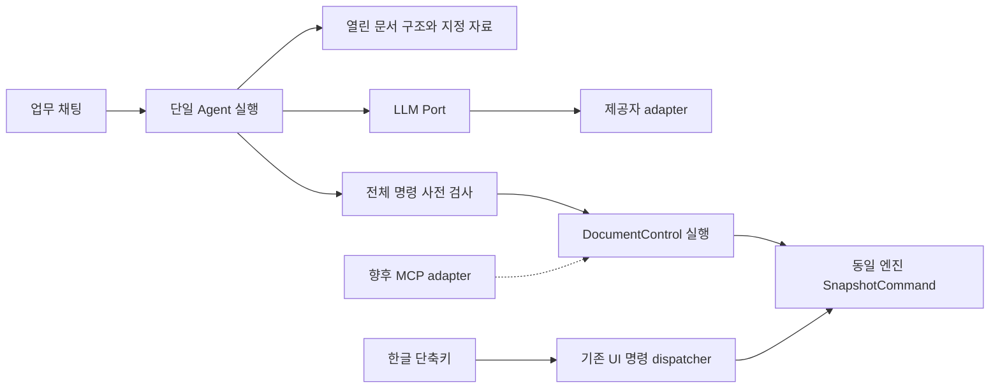

# 한글 단축키와 AI 구조 편집 1차 구현

2026-10-11. [전체 AI 제어 계획](15-ai-editor-control-plan.md)과 [한글 2024 단축키 계획](16-hangul-shortcuts-plan.md)에 따라 구현했다. **단축키 기반과 표·서식·용지 설정의 첫 완주 기능을 제공한다. 전체 한글 기능이나 전체 MCP 계획의 완료는 아니다.**

## 실행

프로젝트 루트의 `Start-Jueony.cmd`를 실행한다. 기본 묶음은 `build/jueony-mvp`다. 이전 서버가 실행 중이면 열린 문서를 저장하고 편집기 창을 닫은 뒤 루트의 **`Restart-Jueony.cmd`**를 실행한다. workspace·채팅은 브라우저 프로필의 저장소에 있으므로 **기존에 쓰던 브라우저·프로필·주소**로 열어야 복원된다. Codex 내부 브라우저에서 사용했다면 서버 재시작 후 그 브라우저의 `http://127.0.0.1:4173/`을 다시 연다. 재시작 도우미는 해당 묶음의 Node 실행 파일과 서버 스크립트 경로가 일치하는 프로세스만 종료한다.

새 화면과 이전 서버가 섞이면 AI 요청을 시작하지 않고 재시작 안내를 표시한다. 구현 중 열려 있던 사용자의 편집 창과 4173 서버는 강제로 종료하지 않았다. 일반 저장·수동 편집 기능을 계속 재사용한다.

## 지금 사용할 수 있는 기능

| 구분 | 동작 | 범위 |
| --- | --- | --- |
| 단축키 | 한글 기본 파일·서식·검색·삽입·표·색상 매핑과 겹글쇠 | `Alt+O/S/V`, `Alt+L/T`, `F6/F7`, `Ctrl+N,T`, `Ctrl+M,R` 등; 지원 목록은 편집기 위 **단축키** 버튼 |
| 키 충돌 교정 | `Ctrl+Y` 줄 삭제, `Alt+Shift+C` 보통 모양, `Ctrl+PageUp/PageDown` 문서 처음/끝 | 기존의 다른 기능 연결 제거; 한글 조합 중 변경 명령 보호 |
| 입력 문맥 | 본문·표·셀 블록·개체와 채팅·대화상자 입력 구분 | 겹글쇠 대기/취소/만료, 물리 키 코드 사용, OS 클립보드 경로 유지 |
| AI 본문 | 새 초안, 여러 본문 삽입·교체·삭제 | 기존 MVP의 제약과 원문 보호 유지 |
| AI 글자 모양 | 굵게·기울임·밑줄·취소선·크기·색상 | 편집 가능한 비어 있지 않은 본문 문단 전체 |
| AI 문단 모양 | 정렬·줄 간격·좌우 여백·들여쓰기·문단 앞뒤 간격·keep 속성 | 단순 본문 문단 |
| AI 표 | 새 표 생성과 데이터 채우기, 기존 단순 셀 교체·비우기 | 표 최대 50행/20열/200셀, 한 셀 한 문단·4,000자; 병합/중첩/혼합 서식 셀은 거절 |
| AI 셀 서식 | 굵기·크기·글자색·배경색·가로/세로 정렬 | 시작 행/열과 **행/열 개수**로 범위 지정; 빈 셀의 글자 서식은 제외 |
| AI 쪽 설정 | 용지 크기·가로/세로·좌우상하·머리말/꼬리말 여백 | 기존 구역별 적용; 새 구역 생성은 미지원 |
| 변경 확인 | 본문과 표·서식·쪽 설정의 전후 값 | 채팅 결과의 **변경 확인**에서 확인 |
| 되돌리기 | 여러 종류의 변경을 요청 단위 한 단계로 복원 | 뒤에 수동 편집이 있으면 요청 undo 거절; 엔진 일반 undo/redo는 기존 경로 |

단축키 목록의 ‘연결됨’은 엔진 명령이 등록되어 있다는 의미다. 모든 문맥·모든 실제 키보드에서 검증되었다는 뜻은 아니다. `Ctrl+N,H/P`, 문서 끼워 넣기, 매크로 등 미지원 연결은 안내하며 다른 기능으로 바꾸어 실행하지 않는다. F3/F5·복잡한 셀/개체와 실제 Windows IME의 세부 동작은 추가 대조가 필요하다. `Ctrl+Home/End` 화면 이동과 `Alt+Home/End` 문단 이동은 구현했으나 다단·각주 등 모든 문맥의 한글 대조 검수는 남아 있다.

## 첫 검증 과제

문서에 `업무 계획`, `추진 일정`, `후속 조치`의 세 문단을 만든 뒤 다음을 요청한다.

> 제목을 16pt 굵게로 바꾸고, 추진 일정 뒤에 4행 3열 표를 만들어줘. 행별 내용은 [단계, 기간, 담당], [준비, 1월, 총무], [실행, 2월, 사업], [점검, 3월, 감사]야. 첫 행만 굵게 하고 배경색 #eeeeee를 적용해줘. 현재 구역을 A4 가로, 좌우상하 여백 각각 20mm로 바꿔줘. 본문 문단의 텍스트는 유지하고 저장은 하지 마.

일반 NAVER Cloud의 저장된 **HCX-005** 서비스 연결로 이 요청을 수행했다. 최종 검사에서는 첫 행만 변경되고 나머지 행의 글자/배경이 유지되는 것까지 확인했다. 모델 출력 품질을 일반적으로 보장하는 결과는 아니다. 초기 끝 행 좌표 계약에서는 두 행을 꾸민 출력이 발생해, 범위 계약을 `startRow + rowCount`, `startColumn + columnCount`로 변경했다. 앱은 모델 결과를 몰래 고치거나 자동 재시도하지 않는다.

검수 파일은 [실제 AI 일정표 HWP](evidence/editor-control-2026-10-11/실제-AI-일정표.hwp), [HWPX](evidence/editor-control-2026-10-11/실제-AI-일정표.hwpx)다. **실제 한글 2024에서 이 새 표본을 재열어 확인하는 검수는 아직 미실행**이다. 한글에서 복구 경고, 4×3 셀 내용, 첫 행만 굵게/회색, 제목 16pt, A4 가로/20mm 여백, 재저장 후 재열기를 확인한다.

## 코드 구조와 명령 계약

| 책임 | 파일 |
| --- | --- |
| 본문·표·셀·쪽 구조 조회 | `apps/editor/src/document-control/structure.ts` |
| 확장 명령 타입/대상/인자 검사와 엔진 호출 | `document-control/operations.ts` |
| 한 요청 내 삽입 후 좌표 갱신 | `document-control/execute.ts` |
| 구조 변경의 사용자 표시 | `document-control/describe.ts` |
| 문서 버전·잠금·요청 undo·실패 복구 | `mvp/editor-bridge.ts`의 기존 SnapshotCommand 경로 |
| 키와 문맥 매핑/키 이벤트 실행 | `shortcuts/keymap.ts`, `shortcuts/install.ts` |
| 제공자별 출력 계약 투영 | `apps/launcher/providers/control-contract.mjs`, `paragraph-contract.mjs` |

공통 명령은 기존 4종에 `format_characters`, `format_paragraph`, `create_table`, `set_table_cell`, `format_table_cells`, `set_page_setup` 6종을 추가했다. 새 표 `resultId`는 요청 안에서 `@resultId`로 참조한다. 위치 ID는 snapshot의 revision과 함께 사용한다. 삽입 후에도 같은 요청의 기존 ID가 원래 문단/표를 가리키도록 실행기가 좌표를 갱신한다. 요청 간 영구 ID를 제공하는 것은 아니다.

HCX-005는 지정 도구를 한 번 호출하며, 명령 배열을 `operationsJson` 문자열로 전송한다. adapter가 JSON을 파싱하고 본문 전체 원문을 대조해 공통 명령으로 바꾼다. 중첩된 함수 인수 schema로 실제 확장 요청이 `40009 Unsupported function`을 반환한 뒤 이 고정 계약으로 변경했다. HCX-007의 구조화 출력 schema와 OpenAI 호환 JSON 출력도 공통 명령으로 합류한다. **문자열 전송은 임의 코드 실행이 아니다.** 앱의 명령 허용 목록·인자·대상·원문·revision 검사가 모두 유지된다.

30개 명령 상한, 본문 60,000자 생성 상한을 유지하고 표 생성 텍스트는 별도로 60,000자까지 제한한다. 구조 조회는 한 표 1,000셀을 넘으면 명시적으로 중단한다. 새 문서 작성은 다른 명령과 한 요청에 섞지 않는다. 저장은 사용자가 실행한다. 편집 중인 원본 파일을 서버에서 다시 쓰지 않는다.

## 검증과 남은 단계

| 검사 | 결과 |
| --- | --- |
| 앱/엔진/단축키/서버 버전 단위 검사 | 29개 통과 |
| 로컬 API·암호화 저장·제공자 계약 | 23개 통과 |
| 기존 workspace/채팅/자료/저장 Edge 통합 | 18개 통과 |
| 단축키 실제 Edge 입력 통합 | 9개 통과 |
| 구조 편집 Edge 통합 | 7개 통과 |
| 실제 HCX-005의 새 복합 요청 | 명령 적용과 전후 비교/요청 undo 통과 |
| TypeScript·Vite 빌드 | 통과 |
| Windows 실행 묶음과 재시작 도우미 | 별도 4203 포트에서 시작·검증된 서버 교체·페이지 응답 통과 |

구조 편집 통합 검사는 적용 중 엔진 실패를 주입해 첫 번째 서식 변경까지 원복되는 것을 확인했다. 렌더 실패와 rollback 자체 실패의 전수 검증은 아니다. HWP/HWPX 동일 엔진 재열기는 검사했으며 한글 독립 검수와 OS 전체 네트워크 차단 검수는 남아 있다. `Ctrl+N,T`는 Edge 키 입력 경로로 성공했다. 실제 물리 키, Windows IME, Tauri 예약키까지 검증한 결과로 확대 해석하지 않는다.

**다음 미완료 작업:** C02/C13 외부 MCP 세션 연결, C04 혼합 서식·컨테이너 본문·문단 이동, C05 고급 서식/스타일, C06 표 행열·병합/중첩·복합 배치, C07 구역·다단, C08 그림/도형/수식/글상자, C09 필드/각주/머리말/검토, C10 AI 파일 명령, K03/K04 나머지 단축키 동작, K05 Windows 호스트, C14 실제 한글 호환성. 기능별 상태는 [목록](ai-editor-capability-matrix.csv)에 남긴다. 외부 MCP 서버는 아직 구현하지 않았다.

재현 스크립트: `apps/editor/scripts/verify-shortcuts.mjs`, `verify-document-control.mjs`, `verify-mvp-isolated.mjs`. 실제 유료 API 검사는 `verify-control-live.mjs --live`로 명시적으로 실행하며 저장된 HCX-005 연결과 합성 문서만 사용한다. 단순 이벤트 테스트와 실제 모델 품질 검사를 구분한다.
