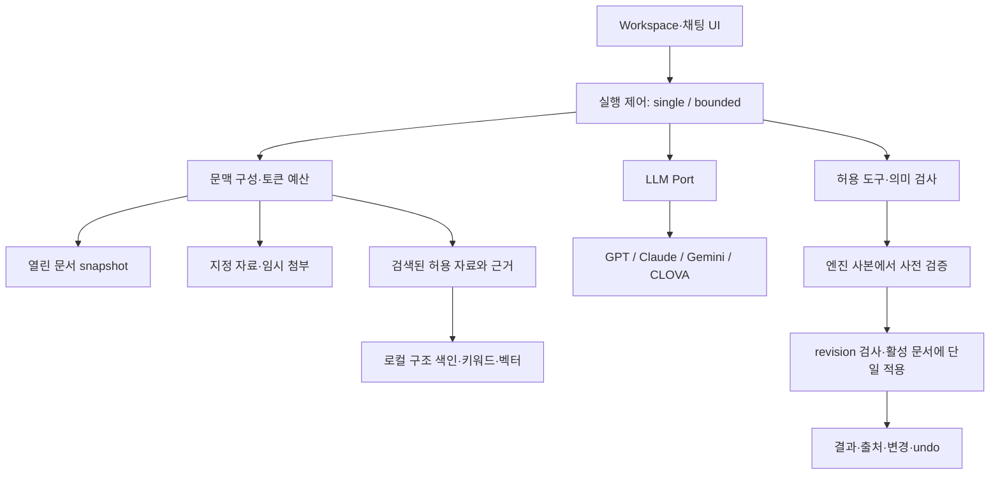

# Jueony Agent: 검색·실행·검증 확장 설계

2026-10-11. **설계이며 RAG/loop 런타임 구현 완료 보고가 아니다.** 현재 코드는 지정 자료 읽기 + 모델 1회 호출 + 검증 + 열린 문서에 적용이다. 이번 요청에서 구현한 것은 [제공자·표·서식·첨부 확장](20-native-providers-and-editing.md)이다.

## 1. 제품에 맞는 도입 순서

먼저 실패를 재현할 평가 세트와 실행 기록을 만들고, 명시한 자료의 구조 추출·출처 위치를 개선한다. 그 다음 로컬 검색, 마지막으로 제한된 반복 실행을 붙인다. 검색 품질과 편집 정확도를 따로 측정한다. 한 번에 충분한 요청을 굳이 반복 실행하지 않는다.

고정 순서의 workflow와 모델이 다음 행동을 선택하는 agent는 서로 다른 책임이다. 단순한 흐름부터 실제 필요에 따라 확장한다는 방향을 채택했다. 외부 프레임워크를 통째로 도입할 필요는 없다. [Anthropic: Building effective agents](https://www.anthropic.com/engineering/building-effective-agents).

제품 흐름은 여전히 “채팅에서 지시 → 실제 문서 직접 편집 → 결과 확인/요청 undo”다. 모든 문단을 승인하거나 복사하는 방식으로 되돌아가지 않는다. 파일 저장·외부 전송의 권한 범위는 편집 권한과 구분한다.

## 2. 현재 코드에 연결할 위치



| 책임 | 현재 재사용 | 추가 위치/변경 |
|---|---|---|
| 현재 문서 읽기/변경 | `mvp/editor-bridge.ts`, `document-control/*` | 구조 위치·자산·병합 셀 경로, 지원 능력 조회 |
| Context | `mvp/references.ts`, `context.ts` | `context/sources.ts`, `context/budget.ts`, `retrieval/*` |
| LLM 호출 | `mvp/llm.ts`, launcher `providers/*` | usage·오류 코드·capability 공통 타입, adapter 내부 변환 |
| 실행 제어 | `mvp/run-once.ts` | `agent/run-bounded.ts`, 정책과 취소·예산 |
| 검증/도구 | `edit-schema.ts`, `document-control/operations.ts` | read/search/stage/validate/commit 도구 목록 |
| 실행 기록 | `Run`, IndexedDB store | 단계별 events, checkpoint, idempotency key |
| 앱 정보 | workspace/폴더 핸들/채팅 | 그대로 유지. 검색 저장소가 앱 상태를 소유하지 않음 |

현재 workspace는 IndexedDB다. SQLite 자료 검색 저장소를 추가할 계획을 “이미 SQLite workspace로 동작”이라고 설명하지 않는다. 향후 네이티브 호스트로 이동해도 이 책임 분리를 유지한다.

## 3. 문서 인식과 출처를 먼저 강화

공문은 제목과 표 머리글을 잃으면 셀 숫자의 의미도 잃는다. 문자열을 고정 길이로만 자르지 않고 `section → paragraph / table → cell → paragraph` 단위로 추출한다. 모델이 보는 텍스트와 원문 위치를 별도로 보관한다.

제안 SourceChunk 계약:

```ts
type SourceChunk = {
  id: string; workspaceId: string; scope: 'common'|'workspace'|'temporary';
  chatId?: string; sourceId: string; sourceVersion: string; contentHash: string;
  locator: {section?:number; paragraph?:number; tablePath?:number[]; cell?:number; pageHint?:number};
  headingPath: string[]; text: string; contextPrefix: string;
  extraction: 'engine'|'utf8'|'ocr'; warnings: string[];
};
```

본문은 제목 경로를 붙인 500~1,000자 후보부터 평가한다. 표는 행을 기본으로 하되 제목·열 이름을 반복해 붙이고 병합 셀의 좌표/범위를 보존한다. 큰 표를 나눌 때 행 간 합계·단위를 별도 메타데이터에 둔다. 이 크기는 실측 전 초기값이다.

검색용 정규화 텍스트와 인용용 원문은 분리한다. Unicode 정규화나 줄바꿈 제거 때문에 편집 offset을 계산하지 않는다. 페이지는 렌더러/글꼴/개정마다 바뀌므로 `pageHint`이며 안정 ID가 아니다. 활성 문서의 미저장 revision을 디스크 색인보다 우선한다. OCR은 추후 로컬 엔진·라이선스·오인식 표시와 함께 도입한다.

출처는 `sourceId + sourceVersion + chunkId + locator`로 해석하고, 현재 파일이 변경됐으면 이전 근거임을 표시한다. 없는 인용 ID는 검증에서 거절한다. 모델이 `sourceIds`를 반환했다고 그 문장의 사실성이 검증된 것은 아니다. 수치·날짜·기관명은 근거 구간과 따로 대조한다.

## 4. 자료 범위와 로컬 색인

세 범위를 명확히 둔다.

- 공통 자료: 사용자가 별도 등록하고 해당 업무에 사용을 허용한 목록. 전역 모든 파일을 자동 포함하지 않는다.
- 업무 자료: workspace에 연결한 폴더. “연결됨 / 검색 준비 중 / 준비됨 / 변경됨 / 읽기 실패”를 구분한다. 폴더 연결은 색인 동의나 완료 표시가 아니다.
- 임시 자료: 현재 채팅/요청에 추가한 파일. 기본 세션 수명, 영구 색인과 분리하고 제거하면 즉시 검색 대상에서도 제외한다.

권한·workspace 필터는 **검색 전 후보 선택과 검색 후 검증 양쪽**에서 적용한다. 벡터 전체 검색 뒤 결과만 걸러내는 방식을 기본으로 삼지 않는다. 해제된 root, 권한이 만료된 파일, 다른 업무의 같은 이름 문서를 제외한다. 참조 근거를 내보내기 직전에도 등록 상태와 버전을 검사한다.

제안 테이블:

| 테이블 | 주요 키/필드 | 규칙 |
|---|---|---|
| sources | workspace_id, scope, source_id, root_id, relative_path, mtime, size, content_hash, parser_version, state | 원본 파일 이동/삭제를 수행하지 않음 |
| chunks | workspace_id, source_id, source_version, chunk_id, locator_json, raw_text, search_text, headings | FK와 삭제 cascade, 검색용 상태 atomic swap |
| chunks_fts | chunk row ID, title, headings, search_text | FTS 갱신과 chunks를 같은 transaction에 처리 |
| embeddings | chunk_id, source_version, model_id, model_digest, dimensions, vector | 모델별 분리, 다른 모델 벡터 혼합 금지 |
| index_jobs | job_id, scope, cursor, status, error_code, started_at | 재개 가능한 작은 batch, 취소/실패 구분 |

현재 브라우저 File System Access 핸들을 Node에 문자열 경로로 변환해 임의 읽기 권한을 주지 않는다. 브라우저가 허용받은 bytes와 opaque source ID를 전용 인증 API/worker에 전달하는 방식을 먼저 검증한다. 현재 JSON API 크기 제한을 무작정 늘리지 않고 파일별 길이 제한·취소·스트리밍 경로를 별도 설계한다. 네이티브 파일 서비스 도입 시 canonical path, 연결 root, junction/symlink 이탈을 검사한다.

첫 저장소 후보는 SQLite FTS5다. 실제 묶음의 Node SQLite 지원 여부와 FTS5 빌드를 시험하고, 가능하지 않으면 Rust SQLite worker를 패키징한다. 지금 실행에 새 DB 프로세스를 설치하지 않았다. 파서/인덱스 버전 변경은 재색인, 삭제/이동은 tombstone→색인 제거 순서로 처리한다. 파일 watcher만 믿지 않고 요청 전 hash/mtime 검증과 수동 동기화를 제공한다.

## 5. 검색 전략과 평가

1차는 제목·파일명·정확한 사업명·연도·문서번호를 찾는 로컬 lexical 검색이다. FTS5 `unicode61`은 한국어 형태소 분석기가 아니다. `trigram`은 부분 문자열 검색 후보지만 1~2글자 질문을 충분히 처리하지 못하므로 제목/명시 키워드 매칭을 보완한다. BM25 점수 방향(작을수록 우선)을 구현 테스트로 고정한다. [SQLite FTS5](https://www.sqlite.org/fts5.html).

2차는 로컬 한국어/다국어 embedding을 비교 실험한다. 모델 가중치와 런타임의 배포 라이선스, CPU 메모리, 초기 로딩, 양자화 품질을 확인한 뒤 선택한다. 이번 설계에서 다운로드하지 않았고 특정 모델을 이미 채택했다고 표시하지 않는다. 기관망 기본값은 문서 임베딩의 외부 API 전송 금지다.

Hybrid 후보는 lexical 상위 30 + dense 상위 30의 RRF 결합이다. `sum(1/(60+rank))`를 초기식으로 두고 10개 후보까지 줄인다. 서로 다른 점수를 직접 더하는 대신 순위를 결합하는 방법을 참고하되, Elasticsearch를 새 서비스로 설치하지는 않는다. [Elastic RRF](https://www.elastic.co/docs/reference/elasticsearch/rest-apis/reciprocal-rank-fusion).

reranker는 그 다음 실험이며 모든 파일에 적용하지 않는다. 제목·소속 구역 등을 검색용 contextPrefix로 붙이는 방법을 먼저 쓰고, LLM 생성 문맥은 비용·환각·출처 오염을 따로 평가한 후 추가한다. 원문 인용에는 생성 prefix를 섞지 않는다. Contextual Retrieval의 성능 수치를 한국 공문에 그대로 적용하지 않는다. [Anthropic Contextual Retrieval](https://www.anthropic.com/engineering/contextual-retrieval).

초기 예산은 검색 결과 8구간/총 8,000자, 문서별 최대 3구간으로 시작한다. 질문의 명시 파일은 우선하되 무관한 결과로 채우지 않는다. 점수를 확률로 표시하지 않는다. 답을 찾지 못하면 “근거 부족”으로 응답하고 문서 사실을 만들어 넣지 않는다. 재작성 질문은 loop 예산 안에서 한 번만 허용한다.

## 6. 문맥 예산과 모델 능력

현재는 문서·자료 각각 120,000자, 최근 메시지 20개/40,000자 제한이다. 문자는 토큰이 아니므로 향후 `ModelCapabilities`에 context limit, max output, structured output 여부를 명시하고 tokenizer/보수적 추정 + 여유분으로 사전 검사한다. 알 수 없는 모델의 한도를 최신 인기 모델 값으로 추측하지 않는다.

문맥 우선순위는 고정 정책·사용자 요청 → 활성 문서 구조와 편집 대상 원문 → 명시 자료 → 검색 근거 → 최근 대화 → 과거 요약이다. 서식/표 명령에 필요한 ID·원문·revision은 압축해서 버리지 않는다. 큰 문서는 전체 구조 목차 후 관련 구간을 읽되, 전체 문서 편집 요청이면 구간 누락을 표시하고 단계 실행한다.

긴 대화는 완료 결정·남은 항목·근거 ID를 요약하고 원본 메시지는 로컬에 보존한다. 모델 요약은 검증된 사실이나 사용자 명령으로 승격하지 않는다. 필요할 때 원문을 다시 읽을 수 있도록 한다. 문맥 선택과 요약을 별도 책임으로 두는 근거는 [Anthropic Context engineering](https://www.anthropic.com/engineering/effective-context-engineering-for-ai-agents)다.

## 7. 제한된 Agent loop

기본은 single 모드로 유지한다. “자료를 비교해 여러 단계로 작성”처럼 조회가 더 필요한 요청에만 bounded 실행을 선택하고, UI에 실제 단계와 중지 버튼을 표시한다. 모델의 숨은 사고 과정 대신 “자료 검색 / 표 구조 확인 / 편집 검사 / 적용” 같은 수행 결과만 보여준다.

초기 정책 제안: 최대 LLM 4회, 읽기 도구 8회, 총 180초, 동시에 한 문서 한 실행, 최종 문서 commit 1회. 반복되는 동일 요청+같은 상태, 예산 소진, 취소, 사용자 편집, 미지원 기능, 무진행을 종료 조건으로 둔다. 이 숫자는 비용/성공률 실험 후 조정한다.

```text
capture request, workspace, chat, documentId, baseRevision
prepare allowed source set and budget
clone document into a local staging engine
while calls/time/tools remain:
    construct compact context from latest observations
    request one structured action (read/search/stage edits/finish)
    validate action against tool registry, scope and budget
    execute locally; record result code and state digest
    stop on conflict, cancellation, repeated state or unsupported operation
validate staged result (content + structure + export/reopen if requested)
if live revision still equals baseRevision:
    apply validated plan in one SnapshotCommand; verify receipt
else:
    keep live document; report conflict without overwriting
```

staging은 모델용 문서 사본이다. 디스크 원본을 Python이나 별도 프로세스가 다시 쓰지 않는다. 사본 engine snapshot 이식이 undo/dirty/cursor를 보존하는지 먼저 검증하고, 보장할 수 없으면 검증된 명령 계획을 현재 문서에 1회 replay한다. replay 전후 구조 digest를 비교한다. 현재 positional ID는 편집에 따라 바뀌므로 staging 단계별 locator map과 revision을 갱신하고 과거 target을 새 상태에 임의 적용하지 않는다.

대안으로 live 문서에 단계별 commit을 허용하려면, 이미 성공한 단계와 실패 단계를 구분하는 journal·복합 undo·재시작 복원부터 구현해야 한다. 그 전에는 “한 요청 전체 undo”를 약속하면서 여러 단계 snapshot을 흩어 적용하지 않는다.

## 8. 도구 계약·실패 처리·재시도

처음 공개할 내부 도구는 `document.describe`, `document.read`, `sources.search`, `sources.read`, `document.stageEdits`, `document.validate`, `document.commit`, `finish`다. 각 도구에 인자 schema, read/write 구분, 예산 비용, 필요한 capability, 결과/error code를 둔다. 요청의 자료/문서 ID만 접근할 수 있고 arbitrary shell·임의 파일 쓰기·범용 URL fetch는 제공하지 않는다.

syntax/schema 검사 → 대상·원문·수치 검사 → 문서 revision → 실제 엔진 결과 → 저장 결과 순서로 검증한다. 모델이 “완료”라고 출력해도 receipt가 없으면 적용 완료가 아니다. 혼합 글자 서식·개체 등 현재 미지원은 도구 능력 목록에서 제외하고 이유를 반환한다.

read-only 일시 네트워크/429 오류는 명시 예산 내 지수 backoff 후보다. 인증·과금·권한·schema 실패를 자동 재시도하지 않는다. schema repair는 별도 모델 호출 1회 한도이며 원래 요청/근거와 검증 오류만 제공한다. 전송 결과가 불명확한 생성 재요청은 중복 비용 가능성을 표시한다. 편집 commit은 `runId + stageId + beforeRevision + planHash`를 키로 한 중복 방지가 선행돼야 하며 완료 영수증을 재사용한다.

취소 뒤 늦은 모델 응답은 적용하지 않는다. 저장 중 취소는 파일 쓰기 완료 여부와 문서 dirty 상태를 기록한 뒤 결과를 알린다. 재시작한 실행은 자동 재적용하지 않고 interrupted로 복원한다. 원본 사용자 변경을 지우는 자동 rollback은 금지한다.

## 9. RAG/loop 외에 필요한 개선

| 기술 | 적용 목적 | 구현 조건/위치 |
|---|---|---|
| 구조화 출력과 capability manifest | 불가능한 명령 생성 감소 | 현재 schema를 단일 원천으로, schemaVersion·문서별 지원 이유 추가 |
| 근거 기반 작성과 숫자 검사 | 예산·일정·인원 오기 억제 | 날짜 파서·합계 계산 도구, 단위·반올림 명시, 근거 구간 대조 |
| 사전 렌더/저장 검사 | 내용 성공과 파일 성공 분리 | WASM export/reopen + 실제 한글 대조. 같은 엔진 검사만으로 호환성 확정 금지 |
| 관찰 가능성 | 무반응·실패 위치 진단 | requestId, phase, elapsed, provider/model, schema/prompt version, operation count, errorCode, revision |
| 비용/지연 관리 | 예상치 못한 장기 요청 방지 | usage 공통 타입·취소·예산·모델별 실제 토큰 계량; 가격은 고정 하드코딩 금지 |
| 캐시 | 동일 파일 파싱/검색 반복 줄이기 | hash+parser/model version+workspace scope, 권한 회수 즉시 무효화 |
| 문서용 템플릿과 스타일 정책 | 공문 체계·제목·표 일관성 | 사용자 선택 템플릿, 이름·날짜 등 slot 검증; 원본 무단 변경 금지 |
| 평가 회귀/관찰 | 모델·프롬프트 변경의 퇴행 발견 | 아래 평가 세트, fixture와 실모델 결과 별도 기록 |

별도 다중 Agent, GraphRAG, fine-tuning, 자동 웹 탐색, 장기 자율 메모리는 첫 도입 대상에서 제외한다. 검색/편집 실패 분석에서 필요가 확인될 때 비교 실험한다. 강한 모델을 더 많이 호출하는 것만으로 성능 개선을 가정하지 않는다.

자료에 있는 “정책 무시 / 다른 업무 파일 읽기 / 키 전송” 문구는 내용으로만 취급한다. RAG 자체는 prompt injection을 제거하지 못한다. 시스템 프롬프트와 함께 도구 allowlist·범위 검사·비밀 비포함·최소 전송을 사용한다. [OWASP LLM01](https://genai.owasp.org/llmrisk/llm01-prompt-injection/).

## 10. MCP의 위치

앱 내부 Agent가 editor 명령을 호출하는 것만으로 MCP server라고 부르지는 않는다. MCP는 그 도구를 외부 AI 클라이언트에 표준 프로토콜로 공개하는 별도 adapter다. 나중에 내부 도구 registry를 MCP tools/list·tools/call에 연결하되, 열린 편집기 상태와 동일한 session/revision을 사용한다. 파일을 따로 읽는 upstream MCP를 활성 문서의 기준으로 바꾸지 않는다. [MCP 도구 명세, 2025-11-25 판](https://modelcontextprotocol.io/specification/2025-11-25/server/tools).

MCP 외부 노출은 기본 비활성, 로컬 명시 연결, 세션 인증, capability 제한, 요청 출처 표시로 시작한다. 외부 클라이언트의 사용자 권한과 앱 내부 Agent 권한을 혼합하지 않는다. MCP 구현을 먼저 해야 RAG/loop가 가능한 것은 아니다.

## 11. 평가와 도입 관문

실행 trace와 최종 결과를 함께 평가한다. deterministic 검사는 글자·표·서식·revision·무변경 실패를, 사람 검수는 공문 품질·근거 타당성과 한글 레이아웃을 맡는다. LLM judge는 보조 점수이며 유일한 합격 판정으로 사용하지 않는다. [Anthropic Agent evals](https://www.anthropic.com/engineering/demystifying-evals-for-ai-agents).

[평가 사례 목록](agent-evaluation-cases.csv)은 새 기능의 실행 계획이며 전부 실행됐다는 뜻이 아니다. 먼저 합성 정답 corpus 30개 문서/60개 질문을 준비하고, 개발/회귀/보류 세트로 분리한다. 동일 case·source hash·모델 ID·프롬프트·schema·engine version을 기록한다. 모델별 대표 편집 사례는 최소 3회 실행해 변동성도 남긴다.

제안 관문은 프로젝트 초기 목표값이며 달성 보고가 아니다:

- 검색: 정확한 파일/문서번호 질의 Recall@5 ≥95%, 의미 질의 Recall@10 ≥85%; 근거 없음 사례의 근거 날조 0.
- 격리/취소/충돌/키 유출 검사: 실패 0. 한 건이라도 있으면 해당 모드 활성화 중단.
- 편집: 단순 지원 명령의 정답 구조 ≥95%, 데이터 유실·중복 commit 0, undo 구조 hash 일치 100%.
- bounded vs single: 보류 세트 성공률이 개선되고 p95 지연·비용 한도 내일 때만 기본 활성화 후보. 개선 없으면 single 유지.
- 저장: HWP/HWPX 두 형식 재열기 + 실제 한글 대표 복잡 문서 10종 수동 검수, 차이는 알려진 제한/수정 과제로 기록.

## 12. 구현 순서와 완료 산출물

| 단계 | 작업 | 완료 산출물/검사 |
|---|---|---|
| A0 | 실제 키별 연결과 평가 기반 | 4 제공자의 계정 실호출, prompt/schema 버전 기록, 결과 fixture·실모델 구분 |
| A1 | source locator·추출·근거 UI | 표/병합 구조 추출, 인용 클릭 시 원문 위치, changed-source 표시 |
| A2 | 로컬 lexical 검색 | scope별 index 상태, 파일 변경/삭제/권한 철회, 한국어 검색 benchmark |
| A3 | hybrid/reranker 실험 | 후보 모델 라이선스/CPU 측정, ablation과 Recall 비교, 이점 없으면 미도입 |
| A4 | staging 검증·실행 journal | 명령 replay·idempotency·중단 재개·전체 undo, crash/failure injection |
| A5 | bounded loop | capped read/stage/finish, 취소·무진행·예산 종료, single 대비 보류 세트 평가 |
| A6 | 고급 편집 도구 | [전체 기능 목록](ai-editor-capability-matrix.csv)의 스타일·개체·머리말·필드 등, 각 기능별 저장/undo/한글 검수 |
| A7 | 외부 MCP·기관 배포 | 열린 session bridge, 명시 연결과 권한, endpoint·보관·SBOM·배포 정책 검증 |

새 기능이 실패하면 기존 single 모드와 직접 편집·저장을 유지한다. 사용자 동의 없는 폴더 자동 전송이나 새 외부 서비스를 기본값으로 추가하지 않는다. UI/Agent/Provider/편집 엔진을 다시 작성하지 않고 이 경계에서 작게 교체한다.
