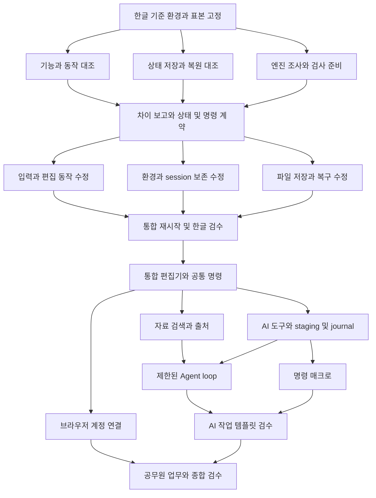

# Jueony 병렬 작업 순서와 통합 검증

2026-10-11. **한글 2024의 기능·동작 점검과 상태 저장을 먼저 맞춘 뒤 Agent를 확장한다.** 이 우선순위를 유지하면서 독립된 조사와 수정은 병렬로 진행한다. [제품 요구사항](24-next-development-plan.md), [한글 및 상태 검수 기준](25-hangul-parity-and-state-plan.md)을 실행할 때의 순서는 이 문서를 따른다.

기본 구성은 **통합 담당 1명 + 작업 담당 A/B/C 3명**이다. 실제 실행 시 서브에이전트 최대 3개를 사용하고 통합 담당은 작업 배분·계약 조정·공용 파일·통합 검사·커밋을 맡는다. 이 문서 작성으로 구현이나 백그라운드 실행이 시작된 것은 아니다.

## 1 전체 순서

| 단계 | 통합 담당 | 병렬 A | 병렬 B | 병렬 C | 다음 단계 진입 기준 |
|---|---|---|---|---|---|
| 0 기준 고정 | H00: 한글 빌드·프로필·표본·현재 commit·검수 방식 고정, 담당 범위 배정 | 공통 기준을 읽고 대기 | 공통 기준을 읽고 대기 | 공통 기준을 읽고 대기 | G0: 같은 기준과 비교 ID 사용, 사용자 작업과 검사 환경 분리 |
| 1 전수 점검 | H01/H02 결과 취합, 누락·중복·차이 분류 | 한글 메뉴·단축키·문맥별 동작과 Jueony 수동 기능 대조 | 문서/환경/보기/session 상태와 저장·복원 수명 대조 | 기존 엔진·명령·직렬화 지원 조사, 표본/회귀 검사 준비 | G1: 기능 목록·상태 계약·차이 보고·우선 수정 목록 확보 |
| 2 기반 수정 | H03: 공용 타입·bridge·shell 연결, 엔진 변경 조정 | 입력·선택·단축키·명령/대화상자 동작 차이 수정 | 환경값·새 문서 기본값·문서별 보기·session 저장/복원 수정 | 파일 저장·원본 재연결·복구·외부 변경/실패 처리 수정 | 각 담당의 변경·의미 있는 검사·남은 차이 제출 |
| 3 기반 통합 검수 | H04: 통합본 고정, 저장·재시작·실제 한글 회귀 및 결함 배분 | 수동 기능 회귀와 자기 영역 결함 수정 | T01~T16 상태 전이 검사와 자기 영역 결함 수정 | HWP/HWPX·실제 한글·강제 종료/저장 실패 검수 | G2: 기본 입력·문서 격리·설정 보존·저장/복구의 중대 결함 없음 |
| 4 통합 편집기 | H05/P01: 한 UI와 공통 명령·상태·receipt 계약 확정 | 한글 흐름의 메뉴/리본/작업 창과 통합 스타일 | H01에 남은 수동 기능을 우선순위대로 보강 | UI·포커스·IME·배율·재실행 회귀, 공무원 업무 표본 보강 | G3: 사용자/단축키/AI가 같은 명령과 상태 사용, 기존 편집/저장 유지 |
| 5 연결·검색·도구 | P02/P03/P05: 연결·Context·명령 통합과 실행 기록 조정 | 브라우저 계정 연결 | 로컬 RAG·출처·자료 범위·변경 갱신 | 검증된 편집 기능의 AI 도구화, staging·journal·중복 적용 방지 | 인증·검색·도구를 각각 판정. G4: loop에 필요한 검색/도구/기록 계약 검증 |
| 6 loop·매크로 | P04/P06/P07: 실행 제어와 결과 비교, 공통 계약 변경 통제 | 제한된 Agent loop·취소·예산·실패 복원 | 명령 매크로·변수·대상 재해석·AI 작업 템플릿 | 남은 고급 기능·실제 한글 호환성·회귀/성능 검사 | G5: single 대비 평가, 반복 작업 재현과 전체 undo·상태 보존 통과 |
| 7 종합 검수 | 결과 취합·잔여 차이 공개·검증된 묶음 커밋/푸시 | 공무원 업무 시나리오 실모델 검사 | 재시작·업데이트·오프라인·복구 검사 | 한글 독립 검수와 전체 기능표 대조 | 기능별 완료/제한/미검증과 실행 방법·검수 파일 제공 |

단계는 달력 날짜가 아니라 의존성과 검증 관문이다. 전수 조사 전에는 작업량과 엔진 결함 규모가 확정되지 않으므로 날짜나 “하룻밤 전체 완성”을 완료 조건으로 잡지 않는다.

## 2 먼저 고정할 의존성

- H01 기능 대조와 H02 상태 대조는 H00 기준을 공유하므로 병렬 수행한다. H03 구현은 관련 대상의 기대 동작과 상태 계약이 정리된 뒤 시작한다.
- 신규 RAG/loop·인증·매크로 구현은 기반 G2와 공통 명령 G3 이후에 진행한다. 기존 Claude single 실행은 회귀 기준으로 유지한다.
- 브라우저 인증의 외부 앱 등록·로그인 대기는 RAG나 문서 도구를 막지 않는다. 기존 검증된 API 연결로 Agent 검사를 진행할 수 있다. 필요한 인증을 대신 성공 처리하지 않는다.
- loop는 최소 로컬 검색/출처와 도구·staging·journal·중복 방지 계약이 필요하다. 임베딩·reranker는 별도 평가 과제이며 첫 loop의 선행 조건이 아니다.
- 명령 매크로는 공통 명령·대상 해석·묶음 적용/undo·실행 기록이 안정되면 시작한다. 명령 매크로 자체는 RAG나 loop가 필요하지 않아 loop와 병렬 가능하다. AI 작업 템플릿의 다단계 검수는 loop와 합친 뒤 수행한다.
- 한글 미구현 수동 기능의 보강은 단계 2부터 계속한다. 기본 편집기 결함은 새 Agent 기능보다 우선하며, 새로 수정한 엔진 기능은 저장/undo/실제 한글 검사 후 AI와 매크로에 공개한다.

## 3 첫 병렬 작업의 정확한 분담

| 담당 | 첫 과제 | 입력 | 산출물 | 수정 범위 |
|---|---|---|---|---|
| 통합 | H00 기준 기록·작업 ID·검수 환경·기능표 형식 확정 | 현재 코드, 한글 2024, 기존 검수 자료 | 기준 manifest, 담당표, 공통 feature/state ID와 증거 경로 | 공통 계획 문서·최종 통합표 |
| A | 사용자 동작 대조 | 기준 한글 메뉴/도움말/단축키와 앱 화면 | 메뉴→명령 매핑, 동작/포커스/취소/undo 차이, 재현 순서 | A 전용 조사 결과와 표본 메모. 제품 코드 수정 없음 |
| B | 상태 보존 대조 | S01~S22와 T01~T16, 기존 설정·workspace·복구 코드 | 한글 범위/수명, 현재 저장 경로, 누락/충돌, restore 순서 계약 | B 전용 상태표와 재현 기록. 제품 코드 수정 없음 |
| C | 엔진과 검수 준비 | rhwp engine/Studio API, HWP/HWPX, 기존 검사 | 재사용 가능/엔진 보강/보존만 가능 분류, 검사 fixture와 harness 계획 | C 전용 표본/검사 파일. 엔진·공용 빌드 수정 없음 |

첫 산출물 경로는 `docs/evidence/hangul-parity/<run-id>/` 아래 `reference/`, `behavior/`, `state/`, `engine/`, `integration/`으로 나눈다. 담당별 결과를 먼저 보존하고 통합 담당만 최종 `hangul-2024-feature-audit.csv`와 `editor-state-contract.csv`를 갱신한다. 여러 작업자가 같은 CSV에 동시에 행을 추가하지 않는다.

실제 한글 환경이 없거나 필요한 기능의 비교가 불가능하면 해당 case를 `BLOCKED_REFERENCE`로 남긴다. 다른 영역의 코드 조사·기능 목록·표본 준비는 계속하지만 예상 동작을 실측값으로 기록하지 않는다.

## 4 수정 단계의 파일 소유권

기본은 같은 작업 폴더에서 **한 파일에 한 담당자**다. 새 단계 시작 시 실제 변경 범위에 맞게 재배정한다. 아래는 출발 배정이며 작업 중 임의로 다른 담당의 파일을 바꾸지 않는다.

| 소유자 | 대표 파일/영역 | 경계 |
|---|---|---|
| 통합 담당 | `apps/editor/src/shell.ts`, `shell.html`, `mvp/model.ts`, `mvp/editor-bridge.ts`, 공용 명령/LLM 계약, `scripts/Build-Standalone.ps1`, `apps/editor/scripts/build.mjs`, 공용 lockfile | 각 담당이 필요한 계약 변경을 전달하면 일관된 형태로 반영. 공용 파일에 동시 patch 금지 |
| A 기본 동작/UI | `src/shortcuts/*`, `chrome-2024.ts`, `editor.css`, 단계별 허용한 UI 모듈과 전용 검사 | shell/bridge 변경은 통합 담당에게 요청. 입력·선택의 엔진 변경은 별도 합의 |
| B 상태 저장 | `mvp/store.ts`, 새 상태 adapter/모듈, 설정 migration 및 전용 검사 | 공유 모델 타입·shell 복원 연결은 통합 담당이 반영. C의 실제 파일 저장/복구 수명과 계약 고정 |
| C 파일/복구/검수 | `save-guard.ts`, `download-save.ts`, `desktop-host.ts`, 전용 저장/재열기 검사 | 세션 DB의 소유 범위는 B와 분리. 복구 데이터 생성/삭제 시점 변경은 먼저 계약 확정 |

새 인증 단계에서는 A가 인증/제공자 연결 파일, B가 자료 추출·검색·출처 파일, C가 문서 제어·AI 도구 파일을 맡도록 소유권을 재배정한다. loop 단계에서는 A가 실행 제어, B가 매크로, C가 호환성/고급 기능으로 이동한다. 공통 프롬프트·명령 schema·RunEvent·저장 모델 변경은 통합 담당이 조정한다.

`upstream/rhwp-source`는 고정 참고 소스다. `.build`와 `dist`의 생성 파일을 직접 고쳐 결과를 유지하지 않는다. Rust/WASM 수정이 필요하면 통합 담당이 별도 패치/분기·버전·빌드·호환성 검사 단위를 먼저 정한다. 같은 엔진 영역을 여러 작업이 동시에 수정하거나 엔진 업그레이드와 상태 migration을 한꺼번에 섞지 않는다.

격리 작업 폴더가 필요하면 각각 기준 commit을 기록하고 사용할 수 있다. 이 경우에도 공용 계약의 소유권은 유지하고 통합 담당이 순서대로 반영한다. 같은 작업 폴더에서 다른 작업자의 변경을 되돌리거나 일괄 정리하지 않는다.

## 5 병렬 실행과 순차 실행의 경계

| 자원/작업 | 실행 방식 |
|---|---|
| 문서/코드 읽기·독립 표본 분석·담당 파일 수정 | 병렬 가능 |
| 독립 단위 검사·별도 출력 폴더의 엔진 검사 | 병렬 가능 |
| 브라우저 E2E | 별도 포트·브라우저 프로필·저장소·다운로드·증거 폴더를 할당한 경우 병렬 가능 |
| 실제 한글 GUI·IME·키보드·클립보드 | 같은 데스크톱에서는 한 담당만 조작. 기준 상태를 복원한 뒤 다음 담당에게 넘김 |
| 공용 타입/schema 변경·DB migration 확정 | 통합 담당이 순서대로 반영하고 영향을 받는 담당에게 계약 버전 전달 |
| 공용 `.build`/`dist` 생성·WASM 교체·실행 묶음 갱신 | 통합 담당만 순차 실행. 실행 중 검사에 사용된 build를 덮어쓰지 않음 |
| Git stage·commit·push | 공유 작업 폴더에서는 통합 담당만 수행. 작업 단위별 파일을 명시해 포함 |
| 사용자 실행 서버/문서/설정 | 검사 환경과 분리. 기존 작업을 강제로 종료하거나 키·프로필을 공유 테스트 상태로 교체하지 않음 |

포트/프로필/출력 경로는 작업 시작 때 사용 여부를 확인하고 할당표에 기록한다. 사용자 서버의 기본 포트 4173을 독립 검사에 재사용하지 않는다. 프로필과 문서에는 합성/검수용 데이터만 넣고 다른 작업의 결과 파일을 재사용해 통과로 오인하지 않게 run ID를 남긴다.

## 6 통합 관문과 완료 판정

| 관문 | 필수 근거 | 통과하지 못했을 때 |
|---|---|---|
| G0 기준 | 한글 빌드·동작 프로필·표본·현재 commit·상태/기능 ID | 관련 비교만 대기. 독립 조사 진행 |
| G1 조사 | 기능 목록과 상태 계약, 차이·재현 순서·담당·우선순위 | 모르는 상태를 임의 설계로 고정하지 않음. 해당 구현을 보류하고 비교 보강 |
| G2 기반 | 기본 입력·선택·단축키·문서 격리·저장/복구·상태 보존, 실제 한글 대표 파일 검수 | 기반 결함을 먼저 수정. 신규 Agent 확장으로 넘어가지 않음 |
| G3 공통 편집기 | 통합 UI와 공통 명령/상태/undo, IME·포커스·저장 회귀 | 공통 계층 결함 수정 후 다음 확장 병렬 시작 |
| G4 실행 도구 | 검색의 자료 범위/버전, staging 검증, revision 충돌, journal·중복 방지·묶음 undo | loop 비활성. 기존 single 편집 유지 |
| G5 Agent/매크로 | 성공률/근거·지연/비용 비교, 취소/예산, 매크로 대상/변수·되돌리기 | 개선이 검증된 기능만 유지하고 실패 범위 기록 |
| 최종 기능 대조 | 고정한 한글 전체 목록의 수동·상태·저장 검수 및 남은 차이 | 부분 완료로 보고. 미구현·미검증을 숨겨 전체 동등성 선언 금지 |

G2는 기본 편집 및 상태 보존 관문이며 한글 모든 기능이 완성됐다는 선언이 아니다. 남은 고급 기능은 담당을 두고 계속 수정한다. 전수 목록의 기능을 “이번에 쓰지 않는다”는 이유로 삭제해 합격률을 올리지 않는다. 실제 한글 기준 검수 없이 내부 엔진 검사만으로 G2의 해당 항목을 통과 처리하지 않는다.

## 7 작업 배분 및 인계 형식

각 작업 지시에는 목표, 선행 결과/계약 버전, 기준 commit, 수정 가능한 파일, 공유 파일 소유자, 재현 표본, 검증 방법, 완료 산출물을 포함한다. 작업 중 다른 담당의 영역이 필요하면 변경 요구와 최소 인터페이스를 통합 담당에게 전달한다.

담당의 완료 보고는 다음을 포함한다:

- 변경한 파일과 실제 사용자 동작의 차이.
- 실행한 검사·입력 hash·코드/build 버전·PASS/FAIL/NOT_RUN·증거 경로.
- 파일/상태 schema·명령 계약 영향과 통합이 필요한 위치.
- 알려진 제한·남은 결함·사용자 환경이 필요한 부분.

통합 담당은 결과를 읽고 공용 파일을 연결한 뒤 해당 범위의 검사와 필요한 통합 회귀를 수행한다. 통과한 동일 검사를 이유 없이 반복하지 않고, 새 통합 변경이나 미해결 우려가 생기면 관련 검사를 추가한다. 중간 완료 단위마다 목적이 분명한 commit을 만들고 검증 상태를 기록한다. 저장소 반영과 전체 제품 완료는 구분한다.

실행 상태는 `대기 / 조사 중 / 구현 중 / 담당 검사 통과 / 통합 검사 중 / 검증 완료 / 환경 대기`로 관리한다. 일정 경과나 담당자의 “완료” 메시지만으로 통합 검증 완료를 표시하지 않는다.

## 8 바로 시작할 작업 묶음

실제 착수 지시가 오면 다음 순서로 시작한다.

1. 통합 담당이 현재 사용자 작업을 보존하고 H00 기준·별도 검사 경로·공통 표 형식을 만든다.
2. A에 기능/동작 전수 대조, B에 상태 저장 대조, C에 엔진/표본/검사 준비를 동시에 배정한다.
3. 통합 담당은 기존 검사 결과·공통 명령/저장 계약·참고 소스 버전을 점검하고, 같은 한글 GUI를 쓰는 검사 순서를 배정한다.
4. 세 결과를 모아 G1 차이 보고와 상태 계약을 확정한다.
5. 확정된 입력/편집, 상태 보존, 파일/복구 결함을 다시 세 작업으로 나눠 수정하고 G2 통합 검수로 모은다.

한글 동작과 상태 보존을 기준으로 작업을 나누고 결과를 합친다. Agent 성능 확대는 이 기반을 사용하는 다음 단계다.
