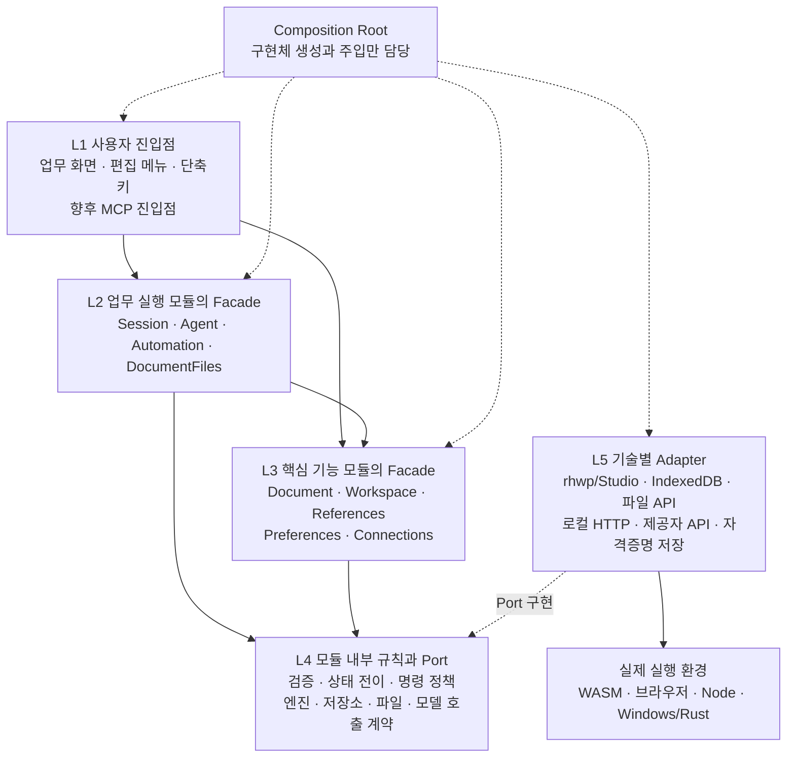

# Jueony 레이어와 모듈 분리 리팩터링 계획

설계 기준: `1386cd4e21defd60e405b7a59e3f46d8080d2010`. 2026-10-11 핵심 모듈 첫 이관을 적용했다. [실제 적용 범위와 남은 이관](32-modular-refactor-result.md)을 확인한다. 아래는 전체 목표 구조이며 계획표의 부분 완료 항목을 전부 구현한 것으로 해석하지 않는다.

목표는 한글 호환 기능을 병렬 개발하기 전에 **모듈별 책임·상태 소유권·공개 계약을 고정하고 내부 구현을 격리하는 것**이다. 문서 엔진과 현재 사용자 동작을 유지하면서 단계적으로 옮긴다. 마이크로서비스, UI 프레임워크 교체, 전면 Rust 재작성, 엔진 업그레이드는 이번 리팩터링에 포함하지 않는다.

계약을 유지하는 내부 변경은 해당 모듈 안에서 끝나도록 한다. 계약·데이터 형식·관찰 가능한 동작이 바뀌면 소비자와 통합 검증에 영향이 생긴다. ‘모든 수정의 영향이 항상 0’이라는 보장 대신 **변경 영향 범위를 명확히 제한하고 CI로 경계 위반을 막는다.**

## 1 위에서 아래로 보는 목표 구조



실행은 위에서 아래로 요청을 전달하지만 **소스 의존성은 Adapter가 내부 Port를 구현하는 방향**이다. Application/Domain이 IndexedDB·rhwp·제공자 SDK를 import하지 않는다. Composition Root만 구체 구현체를 알고 연결한다.

L2와 L3는 서로 다른 종류의 모듈이다. 모든 호출이 중간 레이어를 기계적으로 통과할 필요는 없다. 예를 들어 환경 화면은 PreferencesFacade를 바로 호출한다. 상위 모듈을 하위에서 역참조하거나 다른 모듈 내부에 접근하는 것은 금지한다.

각 모듈 안에서도 같은 원칙을 적용한다.

```text
소비자(UI / 다른 모듈 / 외부 진입점)
  └─ public/            공개 Facade interface · DTO · schema · event
       └─ application/ 유스케이스 · 순서 제어 · Port 호출
            ├─ domain/ 순수 규칙 · 값 타입 · 상태 전이
            └─ ports/  필요한 외부 기능의 최소 interface
                 ↑
              adapters/ 기술 구현체는 Port를 구현하고 밖에서 주입
```

`public`은 모든 내부 파일을 다시 export하는 통로가 아니다. 외부에서 허용한 타입·schema·facade만 명시적으로 export한다. 내부 코드와 Domain 객체, 엔진 참조를 반환하지 않는다. 작은 모듈에 필요 없는 레이어 파일을 형식적으로 만들지 않는다.

## 2 기능 모듈과 Facade 경계

| 레이어 | 모듈 | 외부 공개 Facade | 단독으로 책임질 것 | 소유하지 않을 것 |
|---|---|---|---|---|
| L2 | Session | `SessionFacade` | 활성 업무/채팅/문서, 열린 탭 순서, 전환·닫기·재시작 복원 순서 | 본문, 저장 바이트 생성, Agent 생성 로직 |
| L2 | Agent | `AgentFacade` | 요청 수명, context 조립, single/bounded 실행, 모델 결과 처리, 취소·결과·실행 기록 | 엔진 내부 조작, 파일 직접 수정, 제공자별 HTTP 형식 |
| L2 | Automation | `AutomationFacade` | 매크로 저장·변수·대상 재해석·재실행, 업무 템플릿 | 별도 편집 엔진, LLM 내부 실행 loop, 독자적인 undo |
| L2 | DocumentFiles | `DocumentFilesFacade` | 열기/저장/다른 이름, 원본 연결·fingerprint, 복구본 정책, 저장 결과 확인 | 현재 문서의 본문·revision·history, workspace 저장 전체 |
| L3 | Document | `DocumentQueryFacade` / `DocumentEditFacade` / `DocumentLifecycleFacade` / `DocumentInteractionFacade` | 열린 문서 세대·revision·dirty·선택·undo, 명령 검증·적용 결과, 엔진 지원 능력 | 원본 경로/파일 권한, 채팅/Agent, API 키 |
| L3 | Workspace | `WorkspaceFacade` | 업무, 채팅, 메시지, 소속/접근 범위 검증 | 활성 화면, 문서 내용, 자료 파서, 실행 알고리즘 |
| L3 | References | `ReferenceFacade` | 폴더 연결/자료 목록·임시 첨부의 범위, 추출·검색·근거와 출처 | 문서 수정, 채팅 응답 생성, 전체 Agent loop |
| L3 | Preferences | `PreferencesFacade` | 사용자 환경·새 문서 기본값·문서별 보기/레이아웃 설정과 복원 수명 | 현재 본문의 문서 속성·dirty·undo, 저장 정책 실행 |
| L3 | Connections | `ConnectionFacade` | 제공자/모델 연결 설정, 자격증명 참조, 연결 검사, 허용 endpoint 정책 | Agent 편집 프롬프트/도구, 문서 읽기·저장 |

Document가 가장 큰 기능 영역이므로 **하나의 거대한 EditorFacade** 대신 읽기·편집·수명·사람의 상호작용으로 공개 표면을 나눈다. 소비자는 필요한 면만 받는다. 엔진의 최종 문서 상태는 여전히 rhwp 한 인스턴스가 소유한다. facade가 별도의 편집용 문서 모델을 만들어 동기화하는 구조로 바꾸지 않는다.

Document 내부는 `body`, `formatting`, `table`, `page-section`, `objects`, `fields-review` 기능별 구현으로 분리한다. 기능별 schema/handler/검사를 해당 폴더에서 소유하고, **문서 단위 변경 직렬화·revision·undo 경계만 공통**으로 사용한다. 미구현 개체/검토 기능용 빈 handler는 만들지 않고 기존 명령을 먼저 옮긴다.

References 내부는 `sources → extraction → retrieval → citations`, Agent 내부는 `context → planning → execution → run-records`, Automation은 `templates → bindings → playback`으로 나눈다. RAG와 실행 loop는 제공자 Adapter에 들어가지 않는다.

## 3 허용하는 모듈 의존성

아래는 공개 facade를 소비하는 실행 관계다. 실제 구현은 소비자가 선언한 최소 Port에 상대 facade를 주입한다.

| 소비자 | 허용된 하위 기능 | 금지할 역방향 |
|---|---|---|
| Session | Workspace, DocumentFiles, Document, Preferences, Agent/Automation의 실행 중단·완료 대기 계약 | Agent가 Session의 탭/DOM 상태를 직접 읽는 것 |
| Agent | Workspace의 대화 조회/메시지, Reference의 문맥, Document의 조회/명령, ModelGatewayPort, RunRepositoryPort | Document가 Agent의 Run/Generation/프롬프트를 import하는 것 |
| Automation | Document의 검증/명령, 자신이 소유한 MacroRepositoryPort | Document/Agent가 매크로 저장 모델을 import하는 것 |
| DocumentFiles | Document의 load/export/저장 확인, Preferences의 복구 정책 값, FileAccessPort·RecoveryRepositoryPort | 엔진 Adapter가 저장소 전체/채팅을 수정하는 것 |
| References | Workspace의 소속 조회, Document의 읽기 전용 열린 자료 조회, SourceAccessPort·ParserPort·RetrievalPort | Document가 검색 알고리즘이나 References의 저장 모델을 import하는 것 |
| Document | 자신의 EnginePort/InteractionPort, 주입된 Clock/ID 등 최소 기능 | Agent/Session/Workspace 구현 참조 |
| Workspace / Preferences | 자신이 선언한 RepositoryPort | UI·rhwp·다른 모듈의 private 상태 참조 |
| Connections | ProviderCatalogPort·CredentialVaultPort·ConnectionRepositoryPort·ModelProbePort | 편집 명령 실행, Agent 프롬프트 참조 |

Session의 업무 전환은 실행 취소를 요청하고 이미 적용 단계라면 완료/실패 결과를 기다린 뒤 전환한다. Agent는 활성 DOM을 조회하지 않고 시작 때 고정한 workspace/chat/document/epoch와 자체 실행 상태로 동작한다. 변경 직전에도 Document가 document binding과 revision을 검증한다. 이벤트가 늦게 전달되어도 오래된 명령을 현재 문서에 적용할 수 없어야 한다.

Agent의 `Run`이 Workspace 저장소를 통해 직렬화된다고 해서 Workspace가 실행 알고리즘이나 Agent 구현 타입에 의존해서는 안 된다. 기존 저장 형태의 조합은 **LegacyStateRepository Adapter 내부 DTO**에서만 유지한다.

## 4 실제 프로세스 경계

논리 모듈을 나눈다고 서버를 9개 만들지 않는다. 현재 실행 구조를 유지한다.

```text
브라우저 host / 업무 화면
  UI + Session + Workspace + Agent + References + Automation + Preferences
  Document client adapter ───────┐
                                │ 문서 계약
브라우저 editor iframe          ↓
  Document facade + rhwp adapter + 로컬 Studio/WASM
  IME·키보드·캔버스 렌더링은 iframe 내부

로컬 Node 프로세스
  HTTP inbound adapter + Connections + ModelGateway 구현
  제공자별 adapter + 자격증명/연결 저장 adapter

Windows host
  기존 Rust launcher / 현재 파일 API / 선택적 Tauri adapter
```

- 최초 이관은 현재 same-origin iframe 연결을 **단 하나의 transport adapter 뒤로 감춘다.** 이 단계에서 곧바로 MessageChannel로 전면 교체하지 않는다.
- 직접 `frame.contentWindow.jueonyEditor`, polling, postMessage 처리는 transport adapter만 허용한다. UI와 Agent는 facade만 받는다.
- 교체 가능한 문서 transport 계약은 비동기로 설계한다. 나중에 RPC로 바꾸어도 application 계약은 유지한다. 프로세스 간 데이터는 런타임 검증한다.
- 현재 공개 `executeCommand(string, Record<string, unknown>)`를 LLM/MCP용 범용 실행으로 확대하지 않는다. 사람의 메뉴/대화상자는 별도 interaction 계약, 자동 편집은 검증된 명령 계약을 사용한다.
- 모든 IME 조합·커서 이동·렌더 호출을 host 왕복 RPC로 바꾸지 않는다. 엔진에 밀접한 입력 경로는 rhwp adapter 내부에 남기며 같은 document history/revision을 사용한다.

## 5 권장 소스 배치

다음은 목표 경로다. 초기에는 논리 경계와 import 규칙을 만들고, 대규모 경로 이동은 각 이관 작업에 묶는다. 별도 npm 배포 패키지는 당장 만들지 않는다.

```text
jueony/
├─ modules/
│  ├─ document/
│  │  ├─ public/                 facade · 명령/결과 DTO · schema · capabilities
│  │  ├─ application/            세션 수명 · transaction · 읽기/편집 유스케이스
│  │  ├─ domain/                 revision · 대상 · 서식/단위 · 순수 검증
│  │  ├─ features/               body · formatting · table · page-section 등
│  │  └─ ports/                  EnginePort · InteractionPort
│  ├─ document-files/            저장/복구 · FileAccessPort · RecoveryRepositoryPort
│  ├─ workspace/                 업무/채팅 · WorkspaceRepositoryPort
│  ├─ references/                자료/추출/검색/근거 · ParserPort 등
│  ├─ preferences/               설정 수명 · PreferencesRepositoryPort
│  ├─ connections/               연결/인증 · Vault/ProviderCatalog/ModelProbe Port
│  ├─ agent/                     실행/문맥/계획 · ModelGatewayPort · RunRepositoryPort
│  ├─ automation/                매크로/템플릿 · MacroRepositoryPort
│  ├─ session/                   탭/전환/복원 순서 · SessionRepositoryPort
│  └─ kernel/                    ID · Result · 취소/시간 계약만; 업무 타입 없음
├─ apps/editor/src/
│  ├─ composition/               workbench bootstrap / editor bootstrap
│  ├─ ui/                        workspace · chat · folders · connections · chrome
│  ├─ inbound/                   단축키 · UI action → facade 연결
│  └─ adapters/
│     ├─ rhwp/                   엔진/Studio 내부 import의 유일한 위치
│     ├─ editor-transport/       iframe 호출과 검증/이벤트
│     ├─ storage/                IndexedDB/localStorage · LegacyStateV1 mapper
│     ├─ files/                  browser / download / host adapter
│     └─ local-api/              Node 서버 client; bootstrap token은 여기만
├─ apps/launcher/
│  ├─ composition/               서버 구성과 provider registry 조립
│  ├─ transport/http/            route · 인증/origin/Host · body 검증
│  └─ adapters/                  providers · credentials · connections persistence
├─ integrations/rhwp/
│  ├─ manifest                   고정 upstream/WASM · patch 목록/해시
│  ├─ patches/                   기능별 호환 패치와 목적
│  └─ bootstrap/                 필요한 최소 Studio hook
└─ tests/
   ├─ architecture/              import 경계/순환/공개 export 검증
   ├─ contracts/                 schema/adapter 공통 적합성
   └─ scenarios/                 열기·편집·저장·복구·AI의 통합 시나리오
```

`kernel`이나 `shared`에 AppState·Generation·Engine·매크로·제공자별 타입을 모으지 않는다. 이는 기존 `mvp/model.ts`의 결합을 이름만 바꾸어 재현한다. 모듈이 소유한 공개 DTO를 소비하거나, 필요한 최소 정보를 소비자 Port로 받는다.

## 6 현재 코드에서 먼저 끊을 결합

| 현재 코드 | 확인된 문제 | 이관 목표 |
|---|---|---|
| `apps/editor/src/shell.ts` 약 55KB | UI·상태·문서 탭·파일·Agent·설정·매크로·복구 timer가 한 파일에 집중. iframe API를 any로 조회 | UI controller와 Session/Agent/Files 등의 facade 호출로 분해. 최종 shell은 조립 진입점 역할만 |
| `mvp/model.ts:1–27` | 공용 모델이 AgentEvent·RetrievalSummary·매크로·엔진 구조·FileSystemHandle 타입을 참조. Agent/매크로가 다시 model을 참조하는 타입 의존 고리 | 각 모듈의 공개 모델로 이동. 파일 handle은 adapter 내부, AppStateV1은 저장 mapper 내부 |
| `mvp/editor-bridge.ts:11–141` | WASM/이벤트/DOM/메뉴/파일/사전 검사/적용/undo가 하나의 any 기반 bridge에 혼재 | Document facades + rhwp adapter + files workflow + transport adapter |
| `document-control/operations.ts` / `mvp/edit-schema.ts` | 명령 타입·범위 검증·엔진 실행이 함께 있고 model을 역참조 | document public schema / 순수 검증 / feature handler / 엔진 port로 분리 |
| `mvp/llm.ts` | 중립 LLMPort와 HTTP token, 키 저장·연결 관리 client가 한 파일 | Agent ModelGatewayPort / local-api adapter / ConnectionsFacade 분리 |
| `apps/launcher/providers/*-contract.mjs` | Document 명령 형태와 편집 프롬프트가 제공자 디렉터리에 존재 | Document의 canonical schema, Agent의 prompt/context, provider의 wire 변환으로 분리 |
| `mvp/store.ts` / `mvp/model.ts:27` | 업무·메시지·실행·매크로·화면 설정이 하나의 AppState v1에 저장 | 논리 저장 Port 분리; 물리 DB/스키마는 우선 유지하고 한 writer가 호환 mapper로 갱신 |
| `save-guard.ts:41` | 파일 저장 유틸이 window.jueonyEditor·DOM overlay에 직접 의존 | Files 유스케이스 / FileAccessPort / Document 저장 receipt / UI 진행 표시 분리 |
| `apps/editor/scripts/build.mjs` 약 20KB | upstream 문자열 패치 안에 앱 동작·F6·보기·설정 코드가 삽입됨 | 최소 hook + 버전/해시/적용 횟수를 검사하는 patch manifest. 제품 로직은 소스 모듈로 이동 |
| `apps/launcher/server.mjs` | HTTP routing·인증·정적 파일·연결 상태·제공자 생성이 한 진입점에 있음 | 서버 composition / HTTP middleware와 route / connection service / provider adapter |

타입 import 고리는 런타임 순환 실행 버그와 같은 의미가 아니다. 그러나 변경 영향과 독립 빌드를 넓히므로 type-only 의존도 포함해 정리한다. 이미 잘 분리된 save guard·preferences 검증·retrieval·provider 구현은 버리지 않고 소유 모듈로 옮겨 감싼다.

## 7 Facade 계약의 필수 규칙

구체 DTO/호출 예시는 [Facade 계약 설계](31-facade-contracts.md)에 정의한다.

1. **읽기와 변경 분리:** 읽기는 불변 snapshot/projection만 반환한다. 변경은 명령과 결과 receipt를 사용한다. 모델이 내부 상태 객체를 전달받아 직접 바꿀 수 없다.
2. **엔진 노출 금지:** WASM handle, Studio eventBus/inputHandler, DOM, IndexedDB connection, FileSystemHandle, provider SDK 응답을 공개 DTO에 넣지 않는다. 파일 연결은 불투명한 ref로 접근한다.
3. **하나의 명령 정의:** Document 명령의 schema·타입·지원 조건은 Document 소유다. LLM schema, 매크로 검증, 향후 MCP는 이를 투영한다. 제공자별 JSON schema 제약은 adapter에서 변환하고 누락/의미 차이를 시험한다.
4. **형식과 의미를 모두 검증:** schema로 필드/타입을 검사한 뒤 현재 문서·대상·지원 기능·범위·원문/서식·revision을 검증한다. TypeScript 타입만으로 외부 JSON을 신뢰하지 않는다.
5. **수명과 권한을 명시:** workspace/chat/documentId/epoch/revision/requestId를 구분한다. origin·token·actor는 신뢰된 entrypoint가 정하며 모델 출력의 권한 선언을 사용하지 않는다.
6. **실패도 계약:** unsupported/conflict/cancelled/storage/partial/unknown 결과를 구분한다. 예외 문자열이나 성공 boolean 하나로 부분 적용을 숨기지 않는다.
7. **동기화 원칙:** 문서별 변경·undo·저장 확인은 순서가 정해진 경계 안에서 처리한다. UI/Agent/매크로는 같은 문서 상태와 history를 사용한다. 취소 시점과 실행 완료 여부를 분리한다.
8. **이벤트는 관찰용:** 진행·변경 통지는 구독 해제와 scope/sequence를 갖는다. 파일 저장 완료나 편집 권한 확인을 전역 event bus의 best-effort 알림에 의존하지 않는다.
9. **같은 프로세스도 공개 면만:** private 파일로 deep import하지 않는다. bootstrap factory·구체 Adapter 생성은 composition만 허용한다.
10. **기능 없음과 실패 구분:** capability에 없는 기능은 지원하지 않는다고 반환한다. facade를 만들었다고 188행 기능이 구현되는 것은 아니다.

## 8 상태 소유권과 저장 호환성

| 상태 | 유일한 논리 소유자 | 저장 또는 전송 경계 |
|---|---|---|
| 본문·표·개체·선택·revision·dirty·undo | Document의 live engine session | 필요한 projection / export artifact만 외부 전달 |
| 원본 연결·마지막 파일 hash·저장 결과·복구 bytes | DocumentFiles | FileAccess/RecoveryRepository adapter |
| 업무·채팅·메시지 | Workspace | WorkspaceRepository |
| 폴더 연결·임시 자료·색인·출처 | References | SourceRepository/Parser/Retrieval adapter; 현재 임시 수명 유지 |
| 실행 상태·취소·후보·receipt 기록 | Agent | RunRepository; Workspace 메시지는 결과 projection |
| 매크로·변수·재생 이력 | Automation | MacroRepository |
| 기본값·보기/배율·사용자 레이아웃 | Preferences | PreferencesRepository; document content 속성과 구분 |
| 활성 업무/채팅/문서·탭 순서 | Session | SessionRepository; 문서 내용은 재저장하지 않음 |
| 연결 설정·비밀 참조 | Connections | 암호화 저장 adapter; UI에는 hasCredential 등 메타데이터만 |

첫 이관에서는 `jueony-workspaces` DB 이름/버전, 현재 localStorage key, 키 보호 방식, 데이터의 수명을 유지한다. 저장 Port가 여러 개여도 동일 AppState v1을 여러 모듈이 서로 덮어쓰면 안 된다. **하나의 legacy storage coordinator가 writer를 직렬화**하고 논리 저장 영역별 patch를 병합한다. 동일 저장소에서 필요한 원자성은 adapter transaction 안에서 처리하고, 파일·엔진·DB 전체를 원자적이라고 주장하지 않는다.

기존 v1 자료를 읽는 mapper, 다른 모듈 영역을 보존하는 write, 알 수 없는/새 버전 자료의 덮어쓰기 거부, 취소·저장 실패 회귀가 먼저다. DB 분리·형식 변경·커서 영구 복원 같은 새 기능은 이후 별도 migration으로 한다. API 키 재등록이나 업무 데이터 초기화를 리팩터링 완료 방법으로 삼지 않는다.

## 9 이관 순서와 병렬 계획표

세부 작업·의존성·변경 소유자는 [리팩터링 작업표](refactor-work-plan.csv)에 둔다. 아래 순서가 기존 [병렬 구현 계획](26-parallel-execution-plan.md)의 신규 기능 확대보다 먼저 적용된다.

| 단계 | 통합 담당 | A 문서/파일 | B 업무/상태/UI | C 자료/Agent/연결 | 통과 조건 |
|---|---|---|---|---|---|
| 0 기준 고정 | R00: 실행 묶음·상태 사본·현재 검사·known defects 고정 | 문서 표본/저장 결과 | 업무/설정 복원 표본 | 제공자/Agent 계약 표본 | G0: baseline과 검수 환경 확보 |
| 1 경계 확정 | R01 계약, R02 경계 검사, R03 composition/compatibility seam | Document 계약 검토 | 상태 소유권 검토 | LLM/명령 schema 분리 검토 | G1: facade·Port·소유권 고정, fake adapter로 소비자 개발 가능 |
| 2 독립 분리 | 공용 type/manifest 변경 조율 | R04 Document | R06 Workspace, R08 Preferences | R09 Connections | G2: 기존 동작을 새 facade 뒤에서 호출, 공개 면 이외 의존 추가 없음 |
| 3 유스케이스 분리 | 소비자 연결과 오류 계약 검수 | R05 DocumentFiles | R07 References의 저장/범위 이관 지원 | R07 References, R10 Agent, R11 Automation를 의존 순서대로 | G3: 저장/자료/실행 경로가 계약으로 연결 |
| 4 조립부 교체 | R12 Session/UI 연결, R13 transport/build 정리 | 레거시 문서 호출 제거 | UI feature controller 이관 | provider projection/실행 소비자 정리 | G4: shell/서버/빌드가 업무 로직을 소유하지 않음 |
| 5 통합 검증 | R14 저장 호환, R15 회귀/경계 검증 | 엔진·저장·한글 표본 | 상태/재실행/포커스 | 제공자·자료·Agent·매크로 | G5: 경계·기능·데이터 보존 회귀 통과, 이관 shim 제거/잔여 명시 |

B의 지원은 C 소유 파일의 동시 편집을 뜻하지 않는다. 동일 파일은 한 명만 변경한다. 기본 인원은 통합 1명+작업 3명이며, 추가 세션을 만든다는 뜻은 아니다. 이번 산출물은 계획뿐이며 병렬 구현을 시작하지 않았다.

대규모 한 번 이동 대신 **기존 진입점 → 호환 adapter → 새 facade → 기존 구현**으로 감싼 후 기능별로 안쪽을 이동한다. 마지막 소비자를 옮긴 뒤 shim을 제거한다. 매 단계마다 하나의 실행 가능한 경로를 유지하고 이중 저장/이중 명령 실행은 허용하지 않는다.

## 10 병렬 개발 규칙과 변경 영향

- 각 모듈 내부는 담당자가 수정한다. 다른 모듈의 `public` 변경은 소유자 검토와 소비자 계약 검사 후 반영한다. 공통 계약·composition·build/lockfile·저장 migration·통합 Git 작업은 통합 담당이 조율한다.
- 구현체를 전부 알아야 작업할 수 없도록 facade fake와 고정 입출력 표본을 먼저 제공한다. mock 단독 통과는 실제 adapter 동작 보장을 대신하지 않으며 같은 적합성 검사를 양쪽에 실행한다.
- 새 module contract는 feature branch마다 임의로 바꾸지 않는다. 계약 변경 묶음에 기존/신규 fixture, version/capability, migration 여부, 영향 소비자 목록을 포함한다.
- 독립 단위·계약 검사는 병렬 가능하다. GUI/한글/IME는 한 담당, 공용 build 출력·lockfile·migration 통합은 순차다. E2E를 병렬 실행하면 포트·프로필·DB·다운로드 경로를 분리한다.
- API-key, 문서 원본, 현재 실행 서버는 이관 시험 상태로 교체하지 않는다. 기존 보호·취소·오류 경로를 facade 뒤에서 그대로 유지한다.

이관 중 기존 공용 파일의 소유권도 고정한다. 작업표에 여러 작업의 출발 파일로 등장하더라도 동시 수정 권한을 뜻하지 않는다.

| 파일 또는 영역 | 이관 중 수정 소유자 | 다른 담당자의 방식 |
|---|---|---|
| `mvp/model.ts`와 호환 type reexport | 통합 담당 | 각 모듈의 새 public 타입을 제출하고 기존 파일의 alias/제거 변경 요청 |
| `shell.ts`, 공유 HTML, composition, build/lockfile | 통합 담당 | 자신이 만든 controller/facade factory와 연결 요구 제출 |
| `apps/launcher/server.mjs` 진입점 | 통합 담당 | C가 분리한 route/service/adapter를 만들고 진입점 연결 요청 |
| `mvp/store.ts`, LegacyStateV1 mapper/coordinator | B | Agent/Automation/References 담당자는 해당 logical repository 계약과 fixture 제출; B가 저장 연결 반영 |
| Document bridge/handler, file/recovery adapter | A | 다른 담당자는 공개 계약만 사용; 계약 변경은 먼저 통합 |
| Reference/Agent/Automation/Connection 내부 | C 또는 명시적으로 재배정된 단독 담당 | 파일 소유자를 변경하기 전에는 서로 덮어쓰지 않음 |

공용 모델의 타입 이동과 소비자 import 전환을 같은 파일에서 동시에 처리하지 않는다. 먼저 새 공개 타입을 만들고 호환 alias를 설치한 뒤 담당별 소비자를 옮긴다. 이 규칙을 지켜야 계획상의 병렬 작업이 실제 충돌 감소로 이어진다.

| 변경 예 | 주 수정 영역 | 함께 검증할 경계 |
|---|---|---|
| Claude 요청 규격 변경 | provider adapter | ModelGateway 적합성·오류/취소·기존 structured output |
| 검색 알고리즘 개선 | References retrieval 구현 | 동일 scope·SourceBundle/출처·평가 품질 |
| 표 행 추가 내부 개선 | Document table handler/rhwp adapter | Document 명령·undo·HWP/HWPX·실제 한글, 이를 쓰는 Agent/매크로 시나리오 |
| UI 색/배치 변경 | 해당 UI feature | focus/단축키·표시 상태·화면 회귀 |
| 암호화 저장 방식 교체 | credential adapter | 기존 key 복원·실패 시 평문 저장 금지·Connection facade |
| 새 표 명령 추가 | Document public schema/capability+handler | Agent schema projection·macro 허용 범위·향후 MCP 명시 갱신 |
| 파일/DB 형식 변경 | 소유 모듈+storage adapter+manifest | migration/rollback·구버전 읽기·데이터 보존. 모듈 내부 변경으로 취급하지 않음 |

## 11 자동으로 강제할 경계와 완료 기준

실제 도구 추가는 R02에서 현재 TypeScript/build 설정과 맞춰 선택한다. 특정 패키지 설치를 전제로 하지 않는다.

- 모듈 간 import는 상대 모듈 `public`만 허용. `type-only`, dynamic import, 재export도 검사하고 public 밖으로의 순환 의존은 허용하지 않는다.
- application/domain은 `window`, `document`, `indexedDB`, `localStorage`, `fetch`, Node fs/process, `@rhwp/core`, Studio private path를 직접 사용하지 않는다. 필요한 기능은 Port로 주입한다.
- public DTO에 `any`, 실행 함수, DOM/FileSystemHandle/WASM 객체, provider 응답 객체를 허용하지 않는다. 외부 입력은 `unknown`에서 검증한다. 기존 adapter 내부 any는 한정된 이관 예외로 관리한다.
- keymap·리본·AI schema·매크로는 command/capability catalog와 불일치를 검사한다. unsupported 기능을 성공으로 노출하지 않는다.
- DOM event/global/legacy import 예외는 파일·소유자·제거 단계가 있는 allowlist로 관리한다. 새 예외는 기본 거부한다.
- 표·본문·서식·쪽 등 명령별 적합성, 취소/충돌/부분 실패, 저장 후 dirty, workspace 격리, 데이터 재실행, 제공자 projection, offline assets·build patch 재현을 검사한다.

리팩터링 완료는 파일 수나 짧아진 shell 줄 수로 판정하지 않는다. **대표 UI·Agent·매크로 동작이 공개 계약으로만 이어지고, 새로 추가된 경계 위반이 0이며, 기존 사용자 데이터와 검증된 편집/저장 동작이 유지되는 것**이 기준이다. 한글 전체 호환 완료는 별도 [기능 비교 목록](29-hangul-2024-comparison.md)의 검사다.

이번에는 계획·계약 예시·작업표만 작성한다. 기존 F6 충돌/저장 손실 보고 공백 등은 known defect로 유지하며 리팩터링 통과를 기능 수정 완료로 계산하지 않는다. 보존 위험의 재현·차단이 필요한 경우 별도 결함 수정 커밋으로 분리하고, 새 기능의 병렬 확대 전에 해결한다.
